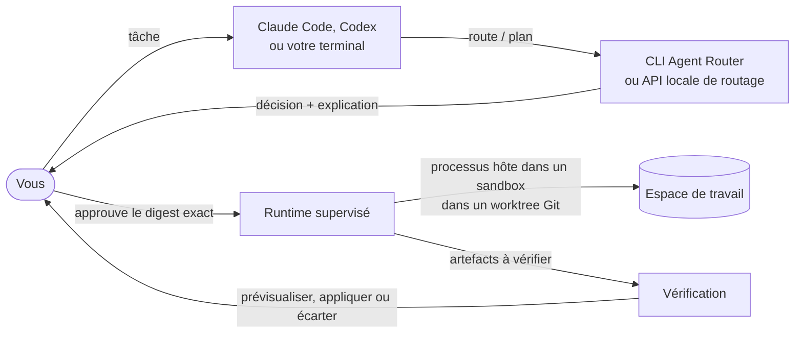
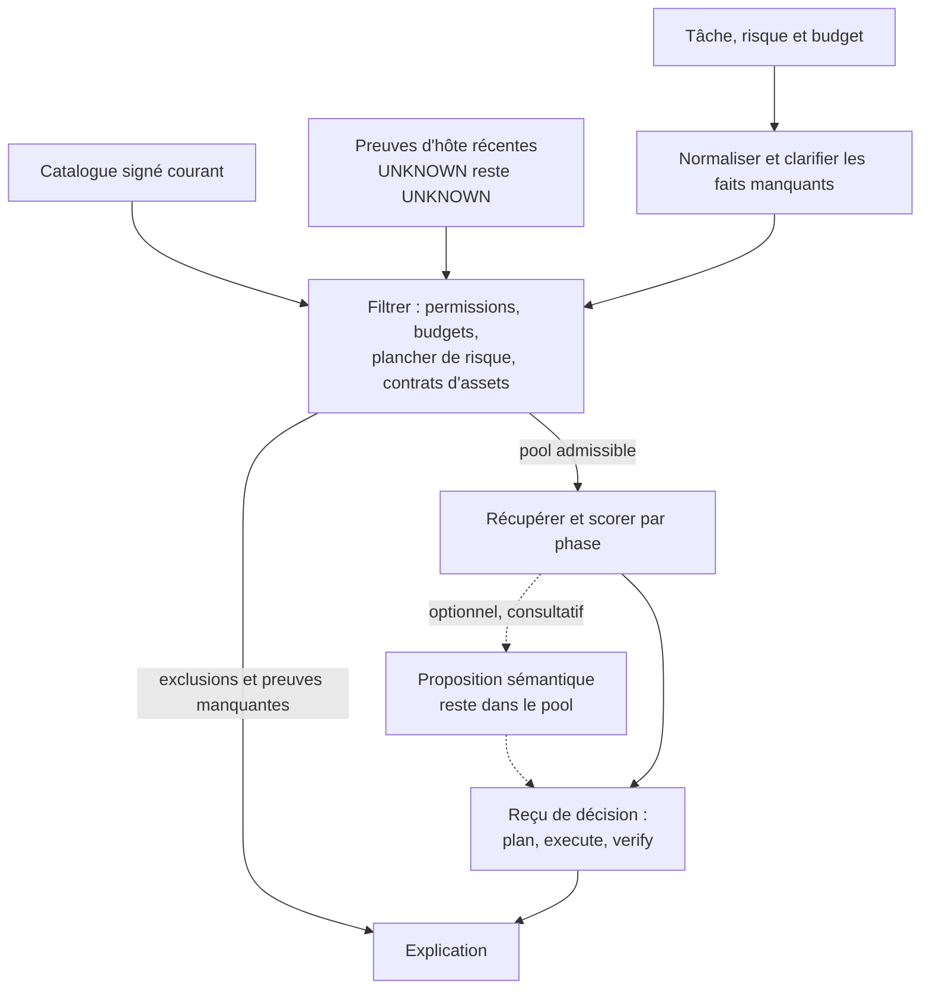

# Agent Router

**Choisissez le modèle, l'effort et les skills pour chaque tâche de code. Relisez la décision. Lancez un workflow approuvé.**

<table>
  <tr>
    <td width="64">
      <a href="https://www.florian.bruniaux.com/about/?utm_source=github&amp;utm_medium=readme&amp;utm_campaign=agent-router"></a>
    </td>
    <td>
      <strong><a href="https://www.florian.bruniaux.com/about/?utm_source=github&amp;utm_medium=readme&amp;utm_campaign=agent-router">Florian BRUNIAUX</a></strong> &middot; AI Founding Engineer @ <a href="https://methode-aristote.fr/">Méthode Aristote</a><br />
      <a href="https://www.florian.bruniaux.com/blog/?utm_source=github&amp;utm_medium=readme&amp;utm_campaign=agent-router">Blog &#8599;</a> &middot; <a href="https://www.florian.bruniaux.com/projects/?utm_source=github&amp;utm_medium=readme&amp;utm_campaign=agent-router">Projets &#8599;</a> &middot; <a href="https://github.com/FlorianBruniaux/ccboard">CCBoard</a>
    </td>
  </tr>
</table>

<p align="center">
  <a href="https://github.com/FlorianBruniaux/agent-router/actions/workflows/ci.yml"></a>
  <a href="https://github.com/FlorianBruniaux/agent-router/actions/workflows/runtime-linux.yml"></a>
  <a href="https://github.com/FlorianBruniaux/agent-router/actions/workflows/dependency-audit.yml"></a>
  <a href="rust-toolchain.toml"></a>
  <a href="licenses/LICENSE-MIT"></a>
  <a href="#prise-en-charge-des-hôtes"></a>
</p>

<p align="center">
  <a href="#démarrage-rapide">Démarrage rapide</a> &middot;
  <a href="#fonctionnalités">Fonctionnalités</a> &middot;
  <a href="#fonctionnement">Fonctionnement</a> &middot;
  <a href="#prise-en-charge-des-hôtes">Prise en charge des hôtes</a> &middot;
  <a href="#documentation">Documentation</a> &middot;
  <a href="https://github.com/FlorianBruniaux/agent-router/issues/11">Feuille de route</a>
</p>

[English](README.md) | Français

Agent Router est une CLI Rust locale qui route le travail de code entre modèles, agents,
skills et outils. Elle vérifie les contraintes avant d'attribuer un score, explique ses choix
et sépare la planification, l'exécution et la vérification. Votre hôte de code reste
propriétaire de son interaction, de ses identifiants et de ses permissions natives.

<p align="center">
  
</p>

<p align="center">
  <a href="docs/media/routing-demo.mp4">Voir la démo</a> &middot;
  <a href="docs/media/README.md">Commandes et reproduction</a>
</p>

La démo utilise des fixtures synthétiques fournies avec le projet et la sortie réelle de la CLI. Elle n'effectue
aucun appel à un modèle. Les noms de modèles dans ces fixtures sont des exemples, pas des affirmations de disponibilité.

## Ce qu'est Agent Router, et ce qu'il n'est pas

Agent Router est une couche de décision locale et déterministe : il choisit le modèle, l'effort et les skills pour chaque phase d'une tâche de code et explique pourquoi. Ce n'est ni un agent de code, ni une passerelle hébergée, ni un exécutant autonome ; votre hôte fait toujours le travail.

<!-- infographic:is-isnt -->
<p align="center"></p>
<!-- /infographic:is-isnt -->

<details>
<summary>Afficher le tableau complet « est / n'est pas »</summary>

| Agent Router est | Agent Router n'est pas |
| --- | --- |
| Une couche de décision locale : elle choisit le modèle, l'effort et les skills pour chaque phase d'une tâche de code et explique pourquoi. | Un agent de code. Votre hôte (Claude Code, Codex, OpenCode, Copilot) fait toujours le travail. |
| Les contraintes d'abord : permissions, budgets, risque et preuves manquantes filtrent les candidats avant tout calcul de score. | Un classement fondé uniquement sur le score. Un score plus élevé ne rend jamais valide un candidat inadmissible. |
| Déterministe et rejouable : les mêmes entrées donnent la même décision, le même reçu et la même explication. | Une boîte noire apprise. Les propositions sémantiques restent optionnelles, consultatives et à l'intérieur du pool admissible. |
| Relecture avant exécution : un lancement exige un digest approuvé, des preuves de capacités récentes et un sandbox OS vérifié. | Un exécutant autonome. Il ne contourne jamais le système de permissions propre à un hôte et ne s'exécute jamais avec les approbations désactivées. |
| Explicite sur l'incertitude : les capacités, coûts et identités d'hôte inconnus restent `UNKNOWN`. | Une source d'affirmations qu'il ne peut pas prouver. Il ne rapporte ni gain, ni niveau de prise en charge, ni identité de modèle sans preuve. |
| Local et hors ligne pour le routage : aucun appel à un fournisseur, aucun daemon ni accès réseau n'est nécessaire pour router. | Une passerelle hébergée, un proxy de modèles ou un courtier d'identifiants. Aucun transport vers un fournisseur n'est câblé à l'exécution aujourd'hui. |
| Un ensemble de bibliothèques Rust bornées plus une CLI, avec des contrats JSON versionnés. | Un paquet qui installe des hooks, des skills ou une configuration globale sur votre machine. |

</details>

## Fonctionnalités

- **Router et expliquer** : sélectionner un modèle et un effort pour plan, execute et verify, et inspecter les exclusions et les preuves manquantes (`route`, `route-phase`, `explain`, `inspect`).
- **Catalogues et recherche** : rechercher dans cinq familles d'assets avec BM25, signaux contextuels, fusion de rangs déterministe et mises à jour incrémentales vérifiées (`catalog`, `index`, `search`, `refresh`). La préparation d'assets signés est disponible via la bibliothèque ; l'exécution signée par la CLI reste un chantier ouvert.
- **Planifier et collecter** : appliquer un plancher de risque, construire l'un des huit presets et classer des affectations globales bornées sous des budgets cumulés ; collecter les faits manquants avec la collecte guidée de tâche (`normalize`, `plan`, `workflow`, `generate-plan`, `task-guide`).
- **Relecture avant exécution** : préparer une requête, lier les assets sélectionnés et approuver le digest d'exécution exact (`assets`, `prepare`, `run`).
- **Exécution durable et coordonnée** : suivre les exécutions, annuler, reprendre et isoler les écritures dans des worktrees Git ; lancer des vagues approuvées ; prévisualiser, appliquer ou écarter un patch vérifié ; réserver de la capacité partagée et des budgets de session.
- **Évaluer et sémantique optionnelle** : rejouer des décisions, évaluer des cohortes explicites et conserver localement les retours consentis ; comparer des propositions sémantiques optionnelles et les résultats du sidecar de classement local (`replay`, `eval`, `feedback`, `policy`, `backend`, `sidecar`).
- **Sortie, configuration et diagnostics** : sortie lisible et `--json`, configuration en couches, `doctor` et une piste d'audit `audit` expurgée.
- **Distribution et release** : espaces de travail source, binaire natif local, contrôles des dépendances, une API locale opt-in limitée au routage (`serve`) et une release locale vérifiable, qui ne signe, ne publie et n'installe jamais rien (l'installation Homebrew elle-même n'est pas encore testée).

<!-- infographic:features -->
<p align="center"></p>
<!-- /infographic:features -->

<details>
<summary>Tableau complet des capacités</summary>

| Capacité | Ce que vous pouvez faire | Interface / guide |
| --- | --- | --- |
| **Routage explicable** | Sélectionner un modèle et un effort pour plan, execute et verify ; inspecter les exclusions et les preuves manquantes. | `route`, `route-phase`, `explain` |
| **Preuves de l'hôte** | Lire les preuves locales d'hôte prises en charge et garder explicites les capacités inconnues. | `inspect`, [contracts](docs/reference/json-contracts.md) |
| **Catalogues et recherche** | Rechercher dans cinq familles d'assets avec BM25, signaux contextuels, fusion de rangs déterministe et mises à jour incrémentales vérifiées. | `catalog`, `index`, `search`, `refresh`, [retrieval](docs/retrieval.md) |
| **Préparation d'assets signés** | Valider le catalogue courant et les autorisations d'éditeur autour de l'assemblage des assets sélectionnés. Disponible via la bibliothèque ; l'exécution signée par la CLI reste un chantier ouvert. | [Signed preparation](docs/signed-preparation.md) |
| **Planification de workflow** | Appliquer un plancher de risque, clarifier les faits manquants et construire l'un des huit presets, puis classer des affectations globales bornées sous des budgets cumulés. | `normalize`, `plan`, `workflow`, `generate-plan`, [plan generation](docs/plan-generation.md) |
| **Collecte guidée de tâche** | Collecter explicitement les faits manquants et exporter une tâche complète sans accorder de permissions implicites. | `task-guide`, [guided intake](docs/task-guide.md) |
| **Sortie lisible et JSON** | Lire les décisions et approbations dans le terminal, ou conserver pour les scripts les résultats complets versionnés avec `--json`. | [CLI output](docs/cli-output.md) |
| **Configuration en couches** | Charger des couches de configuration JSON, TOML ou YAML strictes en préservant la précédence restrictive. | `config --layers`, [formats](docs/configuration-formats.md) |
| **Relecture avant exécution** | Préparer une requête, lier les assets sélectionnés et approuver le digest d'exécution exact. | `assets`, `prepare`, `run`, [execution](docs/cli-execution.md) |
| **Exécution durable** | Suivre les exécutions, annuler le travail, reprendre les tentatives interrompues et isoler les écritures dans des worktrees Git. | `status`, `cancel`, `events`, [runtime](docs/runtime.md) |
| **Capacité partagée et budgets de session** | Réserver de la capacité et des allocations prudentes de coût/tokens entre les racines runtime ; relire toute allocation supplémentaire par rapport au registre courant. | `admission`, `admission budget`, [budgets](docs/session-budgets.md) |
| **Workflows coordonnés** | Lancer des vagues approuvées, transmettre des artefacts déclarés et exiger une vérification avant l'intégration. | `coordinate`, [coordination](docs/coordinator.md) |
| **Intégration explicite** | Prévisualiser, appliquer ou écarter un patch vérifié ; contrôler la rétention et la purge des sorties. | `artifacts`, [controls](docs/cli-execution.md) |
| **Évaluation et retours** | Rejouer des décisions, rapporter le succès sous budget et la calibration sur des cohortes explicites, et conserver localement les retours consentis. | `replay`, `eval`, `feedback`, `policy` |
| **Décisions sémantiques optionnelles** | Comparer des propositions en mode shadow, puis relire des preuves signées, activer explicitement et révoquer avant l'envoi. | `backend`, `backend-activation`, [execution binding](docs/backend-execution.md) |
| **Sidecar de classement local** | Comparer des propositions de classement bornées et envoyer explicitement des résultats ou retours choisis sous le consentement en cours. | `sidecar`, [protocol and consent](docs/standard-sidecar.md) |
| **Diagnostics et audit** | Inspecter la configuration et le stockage runtime actif sans reprise ; garder inconnues l'autorité sur les processus et sur le nettoyage, et exporter une piste d'audit expurgée. | `doctor`, `audit`, [diagnostics](docs/doctor.md) |
| **Distributions séparées** | Exporter des espaces de travail source ou construire un binaire natif local avec licences, inventaires et contrôles de reproductibilité vérifiés. | [Distribution](docs/distribution.md) |
| **Contrôles des dépendances** | Vérifier les preuves de licence des sources et auditer le lock de dépendances commité contre une base RustSec récente en CI. | [License evidence](docs/distribution.md#continuous-integration-license-evidence-gate), [security audit](docs/dependency-audit.md) |
| **API locale limitée au routage** | Servir les décisions de routage sur un socket Unix privé avec un jeton ; aucun endpoint d'exécution, de retour ou d'activation. Fonctionnalité de build opt-in. | `serve` (`--features local-api`), [local API](docs/local-api.md) |
| **Release locale vérifiable** | Lier les archives source et binaire à un manifeste canonique, vérifier une signature Ed25519 produite en externe et générer une formule Homebrew. Elle ne signe, ne publie ni n'installe jamais ; l'installation Homebrew elle-même n'est pas encore testée. | [Local release](docs/release-local.md) |

</details>

<details>
<summary>Briques de bibliothèque, pas encore câblées dans la CLI</summary>

| Capacité | Ce qu'elle fait | Guide |
| --- | --- | --- |
| **Cache de décisions consultatif** | Stocke des propositions de backend authentifiées par HMAC ; une entrée en cache est un avis, jamais une autorité. | [ADR 0011](docs/adr/0011-advisory-decision-cache.md) |
| **Importeur inerte** | Transforme un répertoire d'agents et de skills Markdown en candidat de catalogue non signé et en rapport ; ne signe ni n'active rien. | [Importer](docs/importer.md) |
| **Classement vectoriel local** | Classe les assets à partir de vecteurs en virgule fixe fournis par l'appelant, en arithmétique entière exacte, derrière la feature `semantic-ranking`. | [Retrieval](docs/retrieval.md) |
| **Propositions de plan** | Relit un plan proposé par un modèle par rapport à la tâche et aux limites de l'appelant, et rapporte son écart avec la référence ; ne l'approuve jamais. | [Plan proposals](docs/plan-proposals.md) |
| **Séparation des relectures** | Restreint les liens producteur vers relecteur à des fournisseurs déclarés distincts. | [Review separation](docs/review-separation.md) |
| **Validation structurée** | Évalue des contrats de validation typés sur une vue fournie par l'appelant et renvoie un rapport lié à un digest. | [Structured validation](docs/structured-validation.md) |
| **Descripteurs d'adaptateur** | Valide de façon inerte les descripteurs `adapter.json` : noms réservés, points d'entrée liés, aucune activation. | [Descriptor format](integrations/README.md) |
| **Contrats multimodaux** | Type et borne les entrées image, audio, fichier et les sorties JSON ; rien n'est transporté. | [JSON contracts](docs/reference/json-contracts.md) |

</details>

Le projet est en développement actif. La validation humaine du corpus d'évaluation,
l'objectif complet de démarrage et des preuves natives supplémentaires côté hôte restent ouverts.
Voir le [registre d'achèvement](docs/completion.md) et la [feuille de route](https://github.com/FlorianBruniaux/agent-router/issues/11)
pour les critères d'acceptation. La release publique reste conditionnée à une revue de licence et de sécurité.

## Démarrage rapide

### Compiler depuis les sources

Le [guide d'installation](docs/install.md) couvre les prérequis, les features de build optionnelles,
la release locale vérifiable et la désinstallation. Utilisez Rust 1.85 ou plus récent. Le dépôt épingle la toolchain de développement dans
[`rust-toolchain.toml`](rust-toolchain.toml). Un accès en clone est nécessaire tant que le
dépôt est privé.

```sh
git clone git@github.com:FlorianBruniaux/agent-router.git
cd agent-router
cargo build --release --locked -p agent-router-cli -p router-sandbox-helper
./target/release/agent-router --help
```

<details>
<summary>Options de build et limites</summary>

La CLI par défaut inclut les features d'adaptateur Codex et Claude. Pour compiler la CLI de
routage sans ces adaptateurs d'hôte, utilisez `--no-default-features`. Le routage
fonctionne hors ligne dès que les dépendances Cargo sont disponibles ; ni Python ni service
sémantique ne sont nécessaires à l'exécution. Il n'existe ni installation par gestionnaire de paquets publié
ni étape automatique de configuration globale.

</details>

### Router une tâche et lire l'explication

Ces commandes utilisent le catalogue et la requête d'exemple fournis. Elles produisent uniquement
une décision et une explication ; elles ne lancent aucun hôte et n'appellent aucun modèle.

```sh
./target/release/agent-router route \
  --request tests/fixtures/requests/codex-implementation.json \
  --catalog assets/catalogs/codex-core-v1.json \
  --json > /tmp/agent-router-decision.json

./target/release/agent-router explain \
  --decision /tmp/agent-router-decision.json
```

Pour cette fixture, l'explication comprend :

```text
Preset: plan-execute-verify
Plan: gpt-5.6-sol/high -> gpt-5.6-terra/medium -> gpt-5.6-terra/high
Excluded candidates: 13
Missing evidence: 0
```

<details>
<summary>Routage par phase et codes de sortie</summary>

Pour un routage par phase, essayez la fixture synthétique d'hôte observé :

```sh
./target/release/agent-router route-phase \
  --context fixtures/examples/phase-request.json \
  --host-snapshot fixtures/examples/phase-snapshot.json \
  --catalog fixtures/examples/phase-catalog.json \
  --now 100 --json
```

`--now 100` sert uniquement à l'horloge de la fixture. Les preuves d'hôte réelles doivent être récentes.
La plupart des commandes du produit exposent une sortie machine stable via `--json` ; lancez
`agent-router <command> --help` pour connaître les entrées requises. `route` retourne `0` pour une
sélection, `3` pour un résultat valide sans route, `2` pour une entrée invalide et `4` pour une erreur
interne.

</details>

### Lancer un workflow approuvé

Suivez le [guide de préparation](docs/preparation.md), puis le
[guide d'exécution unique](docs/cli-execution.md) ou le [guide de workflow](docs/coordinator.md).
L'exécution exige une autorité d'assets à jour, un digest relu, un stockage explicite
et un sandbox natif fonctionnel. Une sortie de processus réussie est distincte de
la vérification du résultat de la tâche.

## Fonctionnement

Le reçu déterministe consigne la décision et ses preuves. Une proposition
sémantique optionnelle reste dans le pool de candidats admissibles. Des permissions
inconnues ou des assets incompatibles ne peuvent pas devenir valides grâce à un score plus élevé.
L'exécution lie la requête, le binaire, le sandbox et les contrats d'assets à une approbation.
Les étapes de workflow suivantes ne reçoivent que des artefacts déclarés et bornés.

### Où il se place

Vous continuez à travailler dans votre hôte de code ou votre terminal. Agent Router répond à une
seule question, quel modèle, quel effort et quels skills pour chaque phase, et renvoie une
décision que vous pouvez lire avant que quoi que ce soit ne s'exécute.

<details>
<summary>Ouvrir le diagramme : où il se place</summary>



</details>

### Comment une décision est prise

Les contraintes passent en premier. Le score ne classe que des candidats déjà
admissibles, et chaque exclusion est conservée dans l'explication.

<details>
<summary>Ouvrir le diagramme : comment une décision est prise</summary>



</details>

### Ce qui doit être vrai avant tout lancement

Le routage et la préparation n'exécutent jamais rien. Un lancement démarre uniquement quand chaque
contrôle réussit au moment du lancement.

<details>
<summary>Ouvrir le diagramme : ce qui doit être vrai avant tout lancement</summary>


</details>

## Prise en charge des hôtes

Codex et Claude Code ont des adaptateurs CLI ; OpenCode et Copilot sont des adaptateurs optionnels dont les installations natives et les fournisseurs restent non vérifiés. La supervision du runtime existe sur macOS (Seatbelt) et Linux (Bubblewrap) ; l'exécution native sous Windows n'est pas implémentée.

<details>
<summary>Tableau des preuves par hôte et plateforme</summary>

| Hôte / plateforme | Preuves actuelles et limites |
| --- | --- |
| **Codex** | Adaptateur CLI, inspection passive du cache de modèles et décodage du flux natif. L'identité de modèle demandée reste distincte de l'identité observée. |
| **Claude Code** | Adaptateur CLI et inspection explicite du flux natif. Une preuve de modèle ou d'effort manquante reste inconnue. |
| **OpenCode / Copilot** | Adaptateurs CLI optionnels avec configuration approuvée et sondes de version isolées. Les fixtures de protocole et les canaris de sandbox avec faux hôte sont testés ; les installations natives et les fournisseurs restent non vérifiés. [Setup and limits](docs/other-hosts.md). |
| **Autres hôtes** | Des descripteurs d'intégration et des fixtures de conformité synthétiques sont disponibles. [Integration status](integrations/additional-hosts.md) consigne la preuve native restante. |
| **Omnigent** | Traduction de routage hors ligne avec vérifications strictes des paires proposées et de l'éligibilité locale. Pas encore d'endpoint HTTP ni d'intégration de session native. [Contract and limits](integrations/omnigent.md). |
| **macOS** | Superviseur Seatbelt et vrais canaris locaux de sandbox et de reprise. Le nettoyage du groupe de processus n'établit pas le confinement des descendants détachés. |
| **Linux** | Superviseur Bubblewrap avec nettoyage par namespace PID, exercé par la [CI runtime native](https://github.com/FlorianBruniaux/agent-router/actions/workflows/runtime-linux.yml). |
| **Windows** | L'exécution native n'est pas implémentée. |

</details>

Les CLI d'hôte et les identifiants sont fournis séparément. Agent Router ne les installe pas
silencieusement, ne contourne pas leurs systèmes de permissions et ne change pas le modèle
d'une conversation parente existante.

## Documentation

Les guides d'installation, de routage, d'exécution, de release et du harness de développement sont indexés dans le tableau ci-dessous.

<details>
<summary>Index de la documentation</summary>

| Pour commencer | Pour aller plus loin |
| --- | --- |
| [Install Agent Router](docs/install.md) | [Changelog](CHANGELOG.md) |
| [Serve the local route API](docs/local-api.md) | [Build a verifiable local release](docs/release-local.md) |
| [Prepare an execution](docs/preparation.md) | [Asset contracts and trust](docs/asset-contracts.md) |
| [Run, verify and retain outputs](docs/cli-execution.md) | [Runtime and crash recovery](docs/runtime.md) |
| [Coordinate a workflow](docs/coordinator.md) | [JSON contracts](docs/reference/json-contracts.md) |
| [Generate bounded plans](docs/plan-generation.md) | [Durable escalation library](docs/escalation.md) |
| [Search catalogs](docs/retrieval.md) | [Routing architecture](docs/adr/0002-bounded-routing-pipeline.md) |
| [Validate signed catalogs](docs/signed-catalogs.md) | [Omnigent comparison and roadmap](docs/omnigent-comparison.md) |
| [Evaluate decisions](docs/evaluation.md) | [Private feedback and offline policy](docs/feedback.md) |
| [Execute signed backend decisions](docs/backend-execution.md) | [Activation and rollback](docs/backend-store.md) |
| [Inspect diagnostics](docs/doctor.md) | [Performance measurements](docs/performance.md) |
| [Build source distributions](docs/distribution.md) | [Build a local native binary](docs/binary-distribution.md) |
| [Review shared session budgets](docs/session-budgets.md) | [Development harness](docs/harness.md) |

</details>

La [spécification fonctionnelle](docs/specs/functional-specification.md) et la
[spécification technique](docs/specs/technical-specification.md) définissent le
projet dans son ensemble. Le [registre d'achèvement](docs/completion.md) distingue le comportement
livré de l'acceptation encore en attente.

## Développement

```sh
cargo fmt --all -- --check
cargo clippy --workspace --all-targets --all-features --locked -- -D warnings
cargo test --workspace --locked
cargo run -p xtask --locked -- check
```

Les canaris de sandbox natifs sont distincts de la suite de tests ordinaire et exigent
les prérequis de leur plateforme. Voir la [vérification du runtime](docs/runtime.md).
Le harness de développement Codex/Claude partagé est distinct du produit.
Aucune instruction globale, aucun hook ni aucun skill n'est installé par ces commandes.

Utilisez le [suivi des tickets](https://github.com/FlorianBruniaux/agent-router/issues)
pour les bugs et les demandes de fonctionnalité. Indiquez la commande, la version, la plateforme et une
reproduction expurgée. Gardez les identifiants, les prompts et les données de politique privées hors
des rapports.

## Licence

Le projet est sous licence [MIT](licenses/LICENSE-MIT) ou
[Apache 2.0](licenses/LICENSE-APACHE), à votre choix. La provenance des dépendances, l'inventaire
des licences et les limites de la revue de release sont documentés dans le
[guide de distribution](docs/distribution.md).
