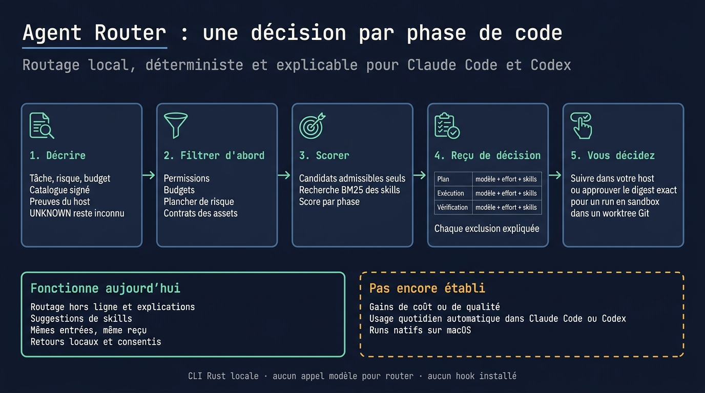
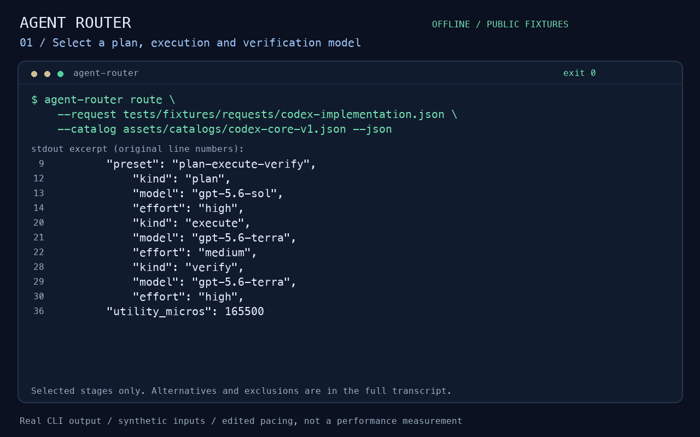
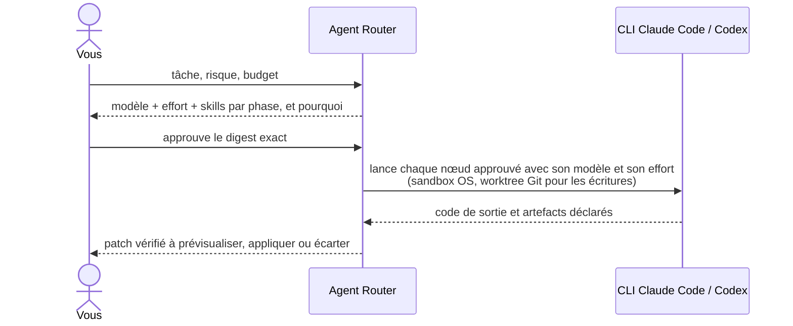
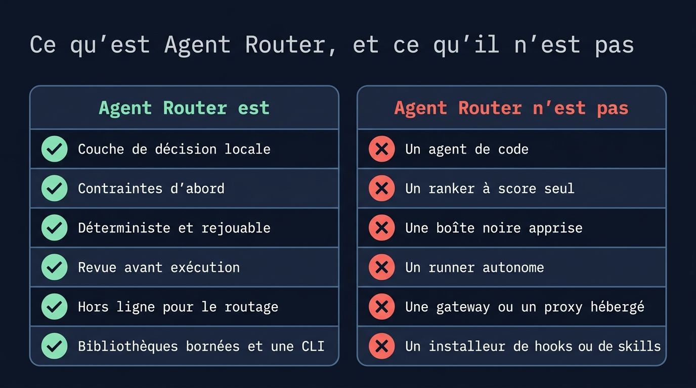
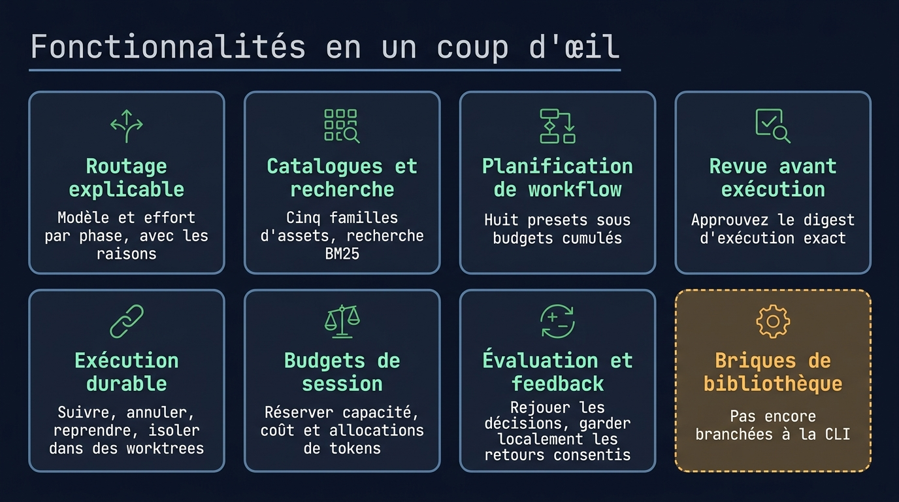
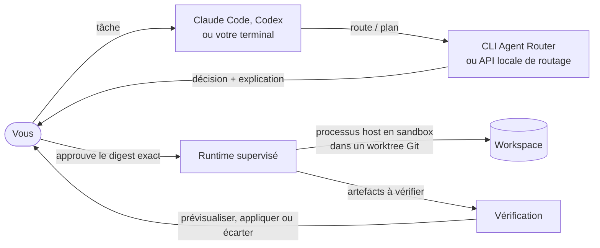
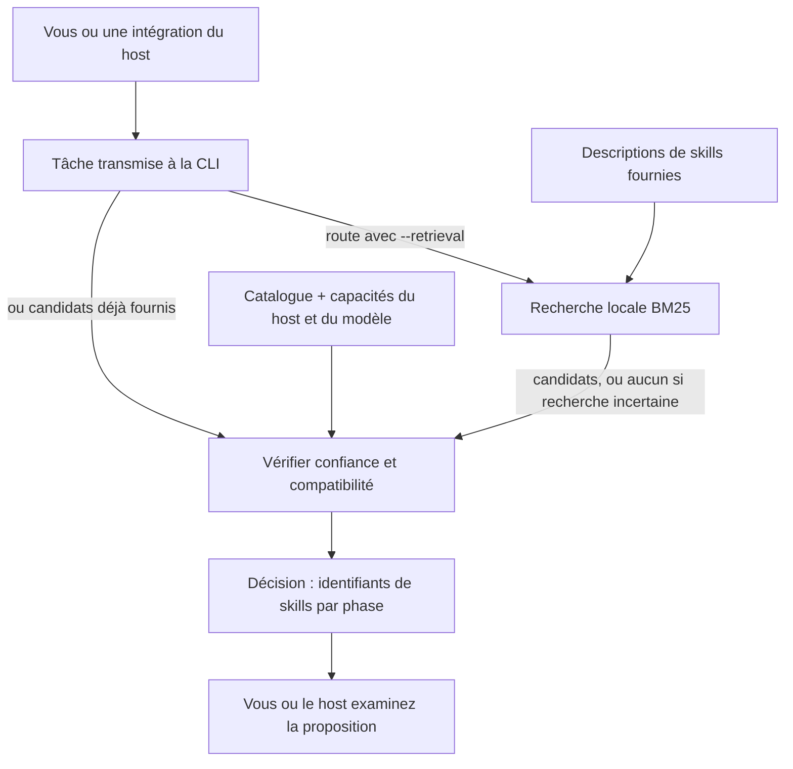
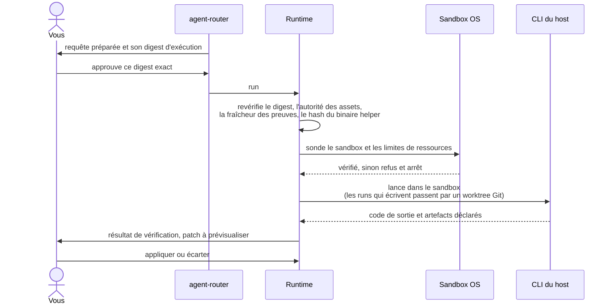

# Agent Router

**Choisir le modèle, l'effort et les skills pour chaque phase de code.**

Un routage expérimental, local et explicable pour Claude Code et Codex.

<table>
  <tr>
    <td width="64">
      <a href="https://www.florian.bruniaux.com/about/?utm_source=github&amp;utm_medium=readme&amp;utm_campaign=agent-router"></a>
    </td>
    <td>
      <strong><a href="https://www.florian.bruniaux.com/about/?utm_source=github&amp;utm_medium=readme&amp;utm_campaign=agent-router">Florian BRUNIAUX</a></strong> &middot; AI Founding Engineer @ <a href="https://methode-aristote.fr/">Méthode Aristote</a><br />
      <a href="https://www.florian.bruniaux.com/blog/?utm_source=github&amp;utm_medium=readme&amp;utm_campaign=agent-router">Blog &#8599;</a> &middot; <a href="https://www.florian.bruniaux.com/projects/?utm_source=github&amp;utm_medium=readme&amp;utm_campaign=agent-router">Projets &#8599;</a> &middot; <a href="https://github.com/FlorianBruniaux/ccboard">CCBoard</a>
    </td>
  </tr>
</table>

---

<p align="center">
  <a href="https://github.com/FlorianBruniaux/agent-router/actions/workflows/ci.yml"></a>
  <a href="https://github.com/FlorianBruniaux/agent-router/actions/workflows/runtime-linux.yml"></a>
  <a href="https://github.com/FlorianBruniaux/agent-router/actions/workflows/dependency-audit.yml"></a>
  <a href="rust-toolchain.toml"></a>
  <a href="LICENSE.md"></a>
  <a href="#hosts-supportés"></a>
</p>

<p align="center">
  <a href="#pourquoi-ce-projet">Pourquoi</a> &middot;
  <a href="#état-du-projet">État</a> &middot;
  <a href="#démarrage-rapide">Démarrage rapide</a> &middot;
  <a href="#fonctionnalités">Fonctionnalités</a> &middot;
  <a href="#fonctionnement">Fonctionnement</a> &middot;
  <a href="#hosts-supportés">Hosts supportés</a> &middot;
  <a href="#documentation">Documentation</a> &middot;
  <a href="https://github.com/FlorianBruniaux/agent-router/issues/11">Roadmap</a>
  <br />
  <a href="README.md">English</a> | Français
</p>

---

Agent Router est une CLI Rust locale qui route le travail de code entre modèles,
agents, skills et outils. Elle vérifie les contraintes avant tout scoring, explique
ses choix et sépare planification, exécution et vérification. Votre host (Claude
Code, Codex…) garde la main sur ses interactions, ses identifiants et ses permissions natives.

<!-- infographic:overview -->
<p align="center"></p>
<!-- /infographic:overview -->

<p align="center">
  
</p>

<p align="center">
  <a href="docs/media/routing-demo.mp4">Voir la démo</a> &middot;
  <a href="docs/media/README.md">Commandes pour la reproduire</a>
</p>

La démo utilise des fixtures synthétiques fournies avec le projet et la vraie sortie de la CLI.
Elle n'appelle aucun modèle. Les noms de modèles de ces fixtures sont des exemples, pas une promesse de disponibilité.

---

## Pourquoi ce projet

Un host comme Claude Code ou Codex tourne avec un seul modèle et
un seul niveau d'effort par session, sauf si vous en changez à la main. Prendre un
modèle plus puissant pour planifier, un modèle moins cher pour une modification de
routine ou les bons skills pour la tâche relève de l'habitude. Rien ne garde la
trace de la raison d'un choix, et les limites de permissions ou de budget peuvent
n'apparaître qu'une fois l'agent au travail.

**Ce que vous y gagnez.**

- **Un choix par phase** : planification, exécution et vérification peuvent chacune
  avoir leur modèle, leur effort et leurs skills, au lieu d'un réglage unique pour tout.
- **Les limites d'abord** : permissions, budget, risque et preuves manquantes côté host
  écartent des candidats avant tout scoring.
- **Une décision lisible** : chaque choix et chaque exclusion sont expliqués, et
  rejouer les mêmes entrées redonne le même reçu.
- **Rien ne tourne sans approbation** : vous approuvez un digest exact ; l'exécution
  tourne dans un sandbox, toute écriture passe par un worktree Git et vous
  prévisualisez le patch avant de l'appliquer.

Aucun gain général de coût ou de qualité n'est établi. Le [pilote host-direct](docs/bench/playbook.md#conclusions-of-the-full-run)
rapporte les résultats de 10 petites tâches Python, avec une répétition ; il
n'exerce pas le runtime supervisé d'Agent Router et ne valide pas une intégration
automatique quotidienne aux hosts.



Vous appelez Agent Router depuis un terminal, ou depuis un host via l'API locale
de routage, activable en opt-in. Il ne change pas le modèle de la conversation en
cours : chaque phase approuvée tourne dans son propre processus host.

---

## Ce qu'est Agent Router, et ce qu'il n'est pas

Agent Router est une couche de décision locale et déterministe : il choisit le modèle, l'effort et les skills de chaque phase d'une tâche de code, et explique pourquoi. Ce n'est ni un agent de code, ni une gateway hébergée, ni un runner autonome : c'est toujours votre host qui fait le travail.

<!-- infographic:is-isnt -->
<p align="center"></p>
<!-- /infographic:is-isnt -->

<details>
<summary>Afficher le tableau complet « est / n'est pas »</summary>

| Agent Router est | Agent Router n'est pas |
| --- | --- |
| Une couche de décision locale : elle choisit le modèle, l'effort et les skills de chaque phase d'une tâche de code, et explique pourquoi. | Un agent de code. C'est toujours votre host (Claude Code, Codex, OpenCode, Copilot) qui fait le travail. |
| Contraintes d'abord : permissions, budgets, risque et preuves manquantes filtrent les candidats avant tout scoring. | Un classement au seul score. Un meilleur score ne rend jamais valide un candidat inadmissible. |
| Déterministe et rejouable : les mêmes entrées donnent la même décision, le même reçu et la même explication. | Une boîte noire entraînée. Les propositions sémantiques restent optionnelles, consultatives et cantonnées au pool admissible. |
| Revue avant exécution : un lancement exige un digest approuvé, des preuves de capacités récentes et un sandbox OS vérifié. | Un runner autonome. Il ne contourne jamais le système de permissions d'un host et ne tourne jamais avec les approbations désactivées. |
| Explicite sur l'incertitude : les capacités, coûts et identités de host inconnus restent `UNKNOWN`. | Une source d'affirmations qu'il ne peut pas prouver. Il n'annonce ni gain, ni niveau de support, ni identité de modèle sans preuve. |
| Local et hors ligne pour le routage : router ne demande aucun appel à un provider, aucun daemon ni aucun accès réseau. | Une gateway hébergée, un proxy de modèles ou un broker d'identifiants. L’accès au provider dépend du host ou du parent explicite ; le routage hors ligne n’appelle aucun provider. |
| Un ensemble de bibliothèques Rust bornées, plus une CLI, avec des contrats JSON versionnés. | Un paquet qui installe des hooks, des skills ou une configuration globale sur votre machine. |

</details>

---

## État du projet

État au 27 octobre 2026 : **le routage hors ligne fonctionne ; l’usage
quotidien automatique dans Claude/Codex reste non qualifié.** Les contrôles
ci-dessous portent sur des périmètres de preuve distincts.

| Parcours | Ce qui est vérifié | Limite restante |
| --- | --- | --- |
| Routage hors ligne | Choix du modèle, de l’effort et des skills, filtrage des contraintes et explication reproductible sur les fixtures fournies. | Les déclarations des fixtures ne prouvent pas la disponibilité réelle des modèles. Voir le [test hors ligne](#router-une-tâche-et-lire-lexplication). |
| Exécution native bornée | Parcours Linux ARM64 épinglés avec le vrai client Codex, des réponses écrites à l’avance, un refus effectif de permission et un patch qui passe 18 contrôles publics. | Aucun vrai modèle ni compte fournisseur dans ces essais. [Preuve du parcours parent complet](docs/bench/fresh-finite-entry-2026-10-22/README.md#follow-up-one-complete-fresh-parent-flow) (EN). |
| Application privée et reprise | Application explicite du candidat et cinq cas natifs de reprise épinglés, dont le refus après une écriture partielle ou une modification ultérieure. | Les écritures ne sont pas atomiques face à un crash. Le changement ultérieur d’affichage du diff (#211) a des tests locaux, mais ses cinq cas Linux composés n’ont pas été rejoués. [Preuves de reprise](docs/bench/native-application-resume-2026-10-24/README.md) (EN). |
| Outils de contexte bornés, T1–T4 | Plages exactes de lignes, présentation terminal SGR explicite, récupération intégrale du brut, politique explicite et corpus hors ligne. | Qualification native Linux ARM64 du profil context-v4 **NOT RUN** ; empreinte du catalogue normalisé par le SDK **UNKNOWN**. Le corpus livre **415 octets JSON de plus**, relectures comprises. [Résultats de contexte](docs/bench/rtk-context-offline/README.md) (EN). |
| Résultats et coûts | L’[essai assisté M4 a produit une correction acceptée](docs/bench/m4-fix-integration-2026-10-11.md) ; les usages fournis peuvent alimenter le coût par révision acceptée. | Les montants manquants restent inconnus. Aucun gain général de coût ou de qualité n’est établi. [Preuves M4 conservées](docs/bench/accepted-evidence-2026-10-15/README.md) (EN). |

Les contrôles de qualité des sources et l’archive de sources extraite passent
localement pour le code fusionné dans #195 (`492c956`). Les contrôles distants
tournent sur chaque push et pull request depuis que le dépôt est public
(28 octobre 2026) ; les badges ci-dessus donnent leur résultat actuel. Les preuves natives ci-dessus lient leurs propres
sources et binaires, pas chaque changement ultérieur. Les qualifications Linux
conservent 8 Gio, zéro swap et leurs restrictions d’accès privé. L’admission
native macOS reste bloquée par la
[limite d’espace d’adressage de 8 Gio](docs/bench/macos-memory-followup-2026-10-11/README.md).

La commande `finite-entry` utilise un parent local scripté explicite ; ce n’est
pas un hook automatique pour la conversation en cours. `finite-resume` peut
terminer une application interrompue éligible sans lancer un autre worker.
Ces commandes demandent leur configuration et leurs autorisations documentées ;
le test rapide ci-dessous effectue seulement le routage. Voir le
[protocole d’entrée fraîche](docs/bench/fresh-finite-entry-2026-10-22/README.md)
et le [protocole de reprise](docs/reference/finite-application-resume.md) (EN).

L’[observation passive](docs/run-observation.md), la
[qualification de l’évaluateur](docs/evaluator-qualification.md) et le
[raccordement des usages fournis](docs/supplied-usage-pricing.md) restent
disponibles dans leurs périmètres de preuve respectifs. Les commandes de
compilation de ce dépôt n’installent aucun hook ni configuration globale des hosts.

Ce candidat open source utilise [Apache-2.0](LICENSE.md). Commencez par le [test rapide](#démarrage-rapide).
Le [guide d’essai expérimental](docs/experimental-release.md) (EN) conserve les
preuves historiques d’installation ; l’état daté ci-dessus décrit les intégrations suivantes.

---

## Démarrage rapide

Partez d’un checkout de ce dépôt public. Le
[snapshot public du cœur](https://github.com/FlorianBruniaux/agent-router-core)
a été publié séparément le 22 octobre 2026 ; son README et `DISTRIBUTION.json`
décrivent ce snapshot, qui n’est pas automatiquement synchronisé avec cet arbre.
Aucun tap public, paquet crates.io ni asset de release signé n’est annoncé ici.

Le test ci-dessous compile seulement la CLI de routage, puis choisit et explique
un plan. Il ne demande ni modèle, ni connexion à un host, ni daemon, ni helper,
ni configuration globale.

### Compiler depuis les sources

Le [guide d'installation](docs/install.fr.md) couvre les prérequis, les features de build optionnelles,
la release locale vérifiable et la désinstallation. Il faut Rust 1.85 ou plus récent. Le dépôt épingle la toolchain de développement dans
[`rust-toolchain.toml`](rust-toolchain.toml). Le dépôt est public
depuis le 28 octobre 2026 ; le snapshot public du cœur est une distribution séparée.

```sh
git clone https://github.com/FlorianBruniaux/agent-router.git
cd agent-router
cargo build --locked -p agent-router-cli
./target/debug/agent-router version --json
```

`version --json` décrit ce build ; cette commande n’inspecte ni ne lance de host.
Cargo peut télécharger les dépendances verrouillées pendant la compilation.
Si le cache est complet, ajoutez `--offline` à la commande de compilation.

<details>
<summary>Options de build et limites</summary>

La CLI par défaut inclut les features d'adaptateur Codex et Claude. Pour compiler la CLI de
routage sans ces adaptateurs de host, utilisez `--no-default-features`. Le routage
fonctionne hors ligne dès que les dépendances Cargo sont disponibles ; ni Python ni service
sémantique ne sont nécessaires à l'exécution. Le canal Git épinglé de Cargo
compile les sources ; Homebrew utilise une formule locale explicitement générée.
L'installation ne configure pas automatiquement les hosts au niveau global.

</details>

### Router une tâche et lire l'explication

Ces commandes utilisent le catalogue et la requête d'exemple fournis avec le projet. Elles produisent
seulement une décision et son explication ; elles ne lancent aucun host et n'appellent aucun modèle.
Les noms de modèles et les capacités déclarées dans ces fixtures synthétiques
ne prouvent ni disponibilité actuelle des modèles, ni authentification, ni support natif du host.

```sh
example_dir=$(mktemp -d)
./target/debug/agent-router route \
  --request tests/fixtures/requests/codex-implementation.json \
  --catalog assets/catalogs/codex-core-v1.json \
  --json > "$example_dir/decision.json"

./target/debug/agent-router explain \
  --decision "$example_dir/decision.json"
```

Les deux commandes doivent sortir avec le code `0`. Pour cette fixture, l’explication contient :

```text
Preset: plan-execute-verify
Plan: gpt-5.6-sol/high -> gpt-5.6-terra/medium -> gpt-5.6-terra/high
Excluded candidates: 13
Missing evidence: 0
```

`Missing evidence: 0` concerne les données fournies par la fixture. Ce test
ne réalise aucune correction et ne prouve pas le support actuel des modèles.
Conservez `example_dir` pour inspecter la décision, ou supprimez seulement ce
fichier et ce répertoire une fois le test terminé.

Pour Claude Code, utilisez le catalogue `claude-core-v1`, déclaré par
l'opérateur. Il ne note aucun modèle : le plan ci-dessous est un départage
déterministe entre entrées non notées, pas un jugement de qualité :

```sh
./target/debug/agent-router route \
  --request tests/fixtures/requests/claude-implementation.json \
  --catalog assets/catalogs/claude-core-v1.json \
  --json > "$example_dir/claude-decision.json"

./target/debug/agent-router explain \
  --decision "$example_dir/claude-decision.json"
```

```text
Preset: plan-execute-verify
Plan: claude-opus-5-5/high -> claude-opus-5-5/high -> claude-opus-5-5/high
Excluded candidates: 22
Missing evidence: 0
```

Voir [les notes du catalogue](assets/catalogs/README.md) pour ce que ce
catalogue n'établit pas.

### Décrire votre propre tâche

```sh
./target/debug/agent-router task-guide \
  --text 'Corriger un parseur Rust et vérifier ses tests' --json
```

Résultat attendu : `status: needs_clarification`, code de sortie `3`. C’est une
demande de précisions, pas un échec d’appel à un modèle. Ajoutez `--interactive`
pour répondre aux questions sur le type de tâche, la portée, le risque, les
permissions, les critères d’acceptation et le budget. La
[saisie guidée](docs/task-guide.md) (EN) prépare les faits de la tâche ; elle
n’accorde aucune autorisation d’exécution et n’appelle aucun modèle.

### Obtenir un conseil pour cette tâche

Une fois la tâche complète, `advise` la convertit en requête de routage et
renvoie une recommandation de modèle, d’effort et de skills par phase, ou un
refus expliqué, terminée par la prochaine action manuelle dans votre host. La
commande fonctionne avec les catalogues Codex et Claude Code, reste consultative
et n’exécute rien. Suivez le
[guide du routage consultatif](docs/advisory-route.fr.md), qui couvre aussi le
cas où un support d’outils inconnu écarte tous les modèles.

<details>
<summary>Routage par phase et codes de sortie</summary>

`route-phase` valide les preuves de capacités du host. L’ancien fichier
`fixtures/examples/phase-snapshot.json` n’authentifie pas les capacités déclarées
pour le contrat actuel et est refusé avec `capability.evidence.unauthenticated` ;
`--now 100` ne l’authentifie pas. Voir le
[contrat de preuve des capacités](docs/adr/0021-host-capability-evidence.md) (EN).
Utilisez la fixture `route` ci-dessus pour le test hors ligne autonome.

La plupart des commandes du produit fournissent une sortie machine stable via `--json` ; lancez
`agent-router <command> --help` pour voir les entrées requises. `route` sort avec `0` pour une
sélection, `3` pour un résultat valide sans route, `2` pour une entrée invalide, `4` pour une erreur
interne et `7` pour une erreur d'intégrité ; voir
[les codes de sortie](docs/cli-output.md#exit-codes-and-error-codes).

</details>

### Lancer un workflow approuvé

Ce parcours est distinct du test hors ligne. Compilez `router-sandbox-helper`
séparément et configurez son chemin et son empreinte exacts pour l’exécution
supervisée. [Cargo épinglé](docs/install.fr.md#cargo-depuis-une-révision-git-épinglée)
et la [formule Homebrew locale](docs/install.fr.md#homebrew-formule-locale)
couvrent la distribution à deux binaires.

Suivez le [guide de préparation](docs/preparation.md), puis le
[guide d'une exécution unique](docs/cli-execution.md) ou le [guide des workflows](docs/coordinator.md).
L'exécution exige une autorité d'assets à jour, un digest relu, un stockage explicite
et un sandbox natif fonctionnel. Un processus qui se termine avec succès ne vaut pas
vérification du résultat de la tâche.

---

## Fonctionnalités

- **Router et expliquer** : choisir un modèle et un effort pour plan, execute et verify, puis inspecter les exclusions et les preuves manquantes (`route`, `route-phase`, `explain`, `inspect`).
- **Catalogues et recherche** : chercher dans cinq familles d'assets avec BM25, des signaux de contexte, une fusion de classements déterministe et des mises à jour incrémentales contrôlées (`catalog`, `index`, `search`, `refresh`). La préparation d'assets signés passe par la bibliothèque ; l'exécution signée depuis la CLI est encore en chantier.
- **Planification et saisie de la tâche** : appliquer un plancher de risque, construire l'un des huit presets et classer des affectations globales bornées sous budgets cumulés ; compléter les faits manquants avec la saisie guidée (`normalize`, `plan`, `workflow`, `generate-plan`, `task-guide`).
- **Revue avant exécution** : préparer une requête, lier les assets choisis et approuver le digest d'exécution exact (`assets`, `prepare`, `run`).
- **Exécution durable et coordonnée** : suivre les exécutions, annuler, reprendre et isoler les écritures dans des worktrees Git ; lancer des vagues approuvées ; prévisualiser, appliquer ou écarter un patch vérifié ; réserver de la capacité partagée et des budgets de session.
- **Évaluation et sémantique optionnelle** : rejouer des décisions, évaluer des cohortes explicites et conserver en local le feedback donné avec consentement ; comparer des propositions sémantiques optionnelles et les résultats du sidecar de classement local (`replay`, `eval`, `feedback`, `policy`, `backend`, `sidecar`).
- **Sortie, configuration et diagnostic** : sortie lisible ou `--json`, configuration en couches, `doctor` et une trace d'audit expurgée (`audit`).
- **Distribution et release** : CLI native et helper de sandbox, installation Cargo épinglée, formule Homebrew locale et liaisons de release vérifiables. Aucun paquet public n'est annoncé ; la [qualification](docs/bench/distribution-qualification-2026-10-07.md) consigne les preuves par canal.

<!-- infographic:features -->
<p align="center"></p>
<!-- /infographic:features -->

<details>
<summary>Tableau complet des capacités</summary>

| Capacité | Ce que vous pouvez faire | Interface / guide |
| --- | --- | --- |
| **Routage explicable** | Choisir un modèle et un effort pour plan, execute et verify ; inspecter les exclusions et les preuves manquantes. | `route`, `route-phase`, `explain` |
| **Preuves côté host** | Lire les preuves locales des hosts supportés et garder explicites les capacités inconnues. | `inspect`, [contrats](docs/reference/json-contracts.md) |
| **Catalogues et recherche** | Chercher dans cinq familles d'assets avec BM25, des signaux de contexte, une fusion de classements déterministe et des mises à jour incrémentales contrôlées. | `catalog`, `index`, `search`, `refresh`, [recherche](docs/retrieval.md) |
| **Préparation d'assets signés** | Revalider le catalogue courant et les grants des éditeurs autour de l'assemblage des assets choisis. Disponible via la bibliothèque ; l'exécution signée depuis la CLI est encore en chantier. | [Préparation signée](docs/signed-preparation.md) |
| **Planification de workflow** | Appliquer un plancher de risque, clarifier les faits manquants et construire l'un des huit presets, puis classer des affectations globales bornées sous budgets cumulés. | `normalize`, `plan`, `workflow`, `generate-plan`, [génération de plans](docs/plan-generation.md) |
| **Saisie guidée de la tâche** | Compléter explicitement les faits manquants et exporter une tâche complète sans accorder de permission implicite. | `task-guide`, [saisie guidée](docs/task-guide.md) |
| **Sortie lisible et JSON** | Lire décisions et approbations dans le terminal, ou garder pour vos scripts les résultats complets et versionnés avec `--json`. | [Sortie de la CLI](docs/cli-output.md) |
| **Configuration en couches** | Charger des couches de configuration JSON, TOML ou YAML strictes en conservant la précédence la plus restrictive. | `config --layers`, [formats](docs/configuration-formats.md) |
| **Revue avant exécution** | Préparer une requête, lier les assets choisis et approuver le digest d'exécution exact. | `assets`, `prepare`, `run`, [exécution](docs/cli-execution.md) |
| **Exécution durable** | Suivre les exécutions, annuler le travail, reprendre les tentatives interrompues et isoler les écritures dans des worktrees Git. | `status`, `cancel`, `events`, [runtime](docs/runtime.md) |
| **Capacité partagée et budgets de session** | Réserver de la capacité et des allocations prudentes de coût et de tokens entre racines de runtime ; confronter toute allocation supplémentaire au registre courant. | `admission`, `admission budget`, [budgets](docs/session-budgets.md) |
| **Workflows coordonnés** | Lancer des vagues approuvées, transmettre des artefacts déclarés et exiger une vérification avant l'intégration. | `coordinate`, [coordination](docs/coordinator.md) |
| **Intégration explicite** | Prévisualiser, appliquer ou écarter un patch vérifié ; gérer la rétention et la purge des sorties. | `artifacts`, [contrôles](docs/cli-execution.md) |
| **Évaluation et feedback** | Rejouer des décisions, rendre compte du succès sous budget et de la calibration sur des cohortes explicites, et conserver en local le feedback donné avec consentement. | `replay`, `eval`, `feedback`, `policy` |
| **Décisions sémantiques optionnelles** | Comparer des propositions en mode shadow, puis relire des preuves signées, activer explicitement et révoquer avant l'envoi. | `backend`, `backend-activation`, [liaison à l'exécution](docs/backend-execution.md) |
| **Sidecar de classement local** | Comparer des propositions de classement bornées et envoyer explicitement les résultats ou le feedback choisis, dans le cadre du consentement en cours. | `sidecar`, [protocole et consentement](docs/standard-sidecar.md) |
| **Diagnostic et audit** | Inspecter la configuration et le stockage runtime actif sans déclencher de reprise ; laisser inconnue l'autorité sur les processus et le nettoyage, et exporter une trace d'audit expurgée. | `doctor`, `audit`, [diagnostic](docs/doctor.md) |
| **Appelants programmatiques** | Afficher le JSON Schema d'un contrat de sortie, indiquer en JSON la version du binaire et des contrats pris en charge, résumer les retours en un total global, et générer les complétions shell. | `schema`, `version --json`, `feedback summary`, `completions`, [sortie de la CLI](docs/cli-output.md#commands-for-programmatic-callers) |
| **Distributions séparées** | Exporter des workspaces source ou construire la CLI Claude/Codex par défaut et le helper, avec inventaires de licence et contrôles de reproductibilité sur deux builds. | [Distribution](docs/distribution.md), [export binaire](docs/binary-distribution.md) |
| **Contrôle des dépendances** | Vérifier les preuves de licence des sources et auditer en CI le lockfile commité contre une base RustSec à jour. | [Preuves de licence](docs/distribution.md#continuous-integration-license-evidence-gate), [audit de sécurité](docs/dependency-audit.md) |
| **API locale limitée au routage** | Servir les décisions de routage sur un socket Unix privé, avec un token ; aucun endpoint d'exécution, de feedback ou d'activation. Feature de build à activer en opt-in. | `serve` (`--features local-api`), [API locale](docs/local-api.md) |
| **Release locale vérifiable** | Lier les deux binaires à un manifeste v2, vérifier une signature Ed25519 externe et rendre une formule Homebrew locale ou HTTPS canonique. Le rendu ne signe, ne publie, n'installe rien et ne prouve pas la disponibilité distante de l'asset. | [Release locale](docs/release-local.md) |

</details>

<details>
<summary>Briques de bibliothèque, pas encore branchées sur la CLI</summary>

| Capacité | Ce qu'elle fait | Guide |
| --- | --- | --- |
| **Cache de décisions consultatif** | Stocke des propositions de backend authentifiées par HMAC ; une entrée en cache vaut avis, jamais autorité. | [ADR 0011](docs/adr/0011-advisory-decision-cache.md) |
| **Importeur inerte** | Transforme un répertoire d'agents et de skills Markdown en catalogue candidat non signé, accompagné d'un rapport ; ne signe et n'active rien. | [Importeur](docs/importer.md) |
| **Classement vectoriel local** | Classe les assets à partir de vecteurs en virgule fixe fournis par l'appelant, en arithmétique entière exacte, derrière la feature `semantic-ranking`. | [Recherche](docs/retrieval.md) |
| **Propositions de plan** | Confronte un plan proposé par un modèle à la tâche et aux limites de l'appelant, et rapporte son écart avec la baseline ; ne l'approuve jamais. | [Propositions de plan](docs/plan-proposals.md) |
| **Séparation des revues** | Impose que chaque lien producteur vers relecteur relie des providers déclarés distincts. | [Séparation des revues](docs/review-separation.md) |
| **Validation structurée** | Évalue des contrats de validation typés sur une vue fournie par l'appelant et renvoie un rapport lié à un digest. | [Validation structurée](docs/structured-validation.md) |
| **Descripteurs d'adaptateur** | Valide les descripteurs `adapter.json` de façon inerte : noms réservés, points d'entrée liés, aucune activation. | [Format des descripteurs](integrations/README.md) |
| **Contrats multimodaux** | Type et borne les entrées image, audio et fichier ainsi que les sorties JSON ; rien n'est transporté. | [Contrats JSON](docs/reference/json-contracts.md) |

</details>

Le projet est en développement actif. La validation humaine du corpus d'évaluation,
l'objectif complet de temps de démarrage et des preuves natives supplémentaires côté host restent ouverts.
Les critères d'acceptation sont dans le [registre d'avancement](docs/completion.md) et la [roadmap](https://github.com/FlorianBruniaux/agent-router/issues/11).
Il s'agit d'un candidat source expérimental ; sa publication exige encore une
revue de release et ne vaut pas validation pour la production.

---

## Fonctionnement

Le reçu déterministe consigne la décision et ses preuves. Une proposition
sémantique optionnelle reste dans le pool des candidats admissibles. Un meilleur score
ne peut pas rendre valides des permissions inconnues ou des assets incompatibles.
L'exécution lie la requête, le binaire, le sandbox et les contrats d'assets à une approbation.
Les étapes suivantes du workflow ne reçoivent que des artefacts déclarés et bornés.

### Où il s'insère

Vous continuez à travailler dans votre host ou votre terminal. Agent Router répond à une
seule question : quel modèle, quel effort et quels skills pour chaque phase. Il vous rend une
décision à lire avant que quoi que ce soit ne s'exécute.

<details>
<summary>Ouvrir le diagramme : où il s'insère</summary>



</details>

### Comment une décision est prise

Les contraintes passent en premier. Le scoring ne classe que des candidats déjà
admissibles, et chaque exclusion est conservée dans l'explication.

<details>
<summary>Ouvrir le diagramme : comment une décision est prise</summary>


</details>

### Comment les skills sont suggérés

Un skill est un jeu d’instructions pour guider le travail, par exemple une
méthode de test. Vous, ou une intégration de votre host, fournissez la tâche et
les descriptions de skills à Agent Router. La recherche compare les mots de la
tâche à ces descriptions ; le routeur vérifie ensuite quels candidats sont
compatibles avec le catalogue, la tâche, le host et le modèle retenu.



Cette suggestion ne lit pas encore le contenu des fichiers de skills. Leur
chargement vérifié appartient au parcours de préparation, qui exige ses propres
entrées et contrôles. Agent Router n’installe aucun hook et ne recherche pas
automatiquement dans vos dossiers Claude ou Codex. Sans `--retrieval`, `route`
utilise les candidats fournis dans la requête. Le [guide du parcours des skills](docs/skill-selection.md)
explique les cas d’usage, les refus et un essai hors ligne reproductible.

### Conditions à remplir avant tout lancement

Le routage et la préparation n'exécutent jamais rien. Un lancement ne démarre que si chaque
contrôle passe au moment du lancement.

<details>
<summary>Ouvrir le diagramme : conditions à remplir avant tout lancement</summary>



</details>

---

## Hosts supportés

Codex et Claude Code ont des adaptateurs CLI ; OpenCode et Copilot ont des adaptateurs optionnels, mais leurs installations natives et leurs providers restent non vérifiés. La supervision du runtime existe sur macOS (Seatbelt) et Linux (Bubblewrap) ; l'exécution native sous Windows n'est pas implémentée.

<details>
<summary>Preuves par host et par plateforme</summary>

| Host / plateforme | Preuves actuelles et limites |
| --- | --- |
| **Codex** | Adaptateur CLI, inspection passive du cache de modèles et décodage du flux natif. L'identité de modèle demandée reste distincte de l'identité observée. |
| **Claude Code** | Adaptateur CLI et inspection explicite du flux natif. Une preuve de modèle ou d'effort manquante reste inconnue. |
| **OpenCode / Copilot** | Adaptateurs CLI optionnels, avec configuration approuvée et sondes de version isolées. Les fixtures de protocole et les tests canary de sandbox avec un faux host sont testés ; les installations natives et les providers restent non vérifiés. [Configuration et limites](docs/other-hosts.md). |
| **Autres hosts** | Des descripteurs d'intégration et des fixtures de conformité synthétiques sont disponibles. [État des intégrations](integrations/additional-hosts.md) recense les preuves natives qui manquent encore. |
| **Omnigent** | Traduction de routage hors ligne, avec contrôles stricts des paires proposées et de l'éligibilité locale. Pas encore d'endpoint HTTP ni d'intégration native aux sessions. [Contrat et limites](integrations/omnigent.md). |
| **macOS** | Superviseur Seatbelt et vrais tests canary locaux de sandbox et de reprise. Le nettoyage par groupe de processus n'établit pas le confinement des descendants détachés. |
| **Linux** | Superviseur Bubblewrap avec nettoyage par namespace PID ; les parcours Codex bornés ARM64 épinglés et les preuves d’application/reprise privée sont liés dans l’état daté ci-dessus. Ces preuves historiques sont distinctes de la CI distante actuelle, qui n’a pas démarré pour `492c956`. |
| **Windows** | L'exécution native n'est pas implémentée. |

</details>

Les CLI des hosts et les identifiants sont fournis à part. Agent Router ne les installe pas
en silence, ne contourne pas leurs systèmes de permissions et ne change pas le modèle
d'une conversation parente existante.

L'interception automatique des prompts et l'intégration quotidienne à Claude/Codex
restent non validées. Le [diagnostic app-server Codex](docs/bench/native-integration-u02/README.md)
a observé des paramètres de tour explicites et une sortie scriptée dans un client
jetable ; il ne s'agissait ni d'une intégration Agent Router installée, ni d'une inférence réelle.

---

## Documentation

L'[index complet de la documentation](docs/README.fr.md) classe tous les guides par besoin. Les plus utilisés sont ci-dessous.

<details>
<summary>Index de la documentation</summary>

| Pour commencer | Pour aller plus loin |
| --- | --- |
| [Essayer le routage expérimental hors ligne](docs/experimental-release.md) (EN) | [Preuves d'intégration aux hosts](docs/bench/native-integration-u02/README.md) |
| [Installer Agent Router](docs/install.fr.md) | [Changelog](CHANGELOG.md) |
| [Servir l'API locale de routage](docs/local-api.md) | [Construire une release locale vérifiable](docs/release-local.md) |
| [Préparer une exécution](docs/preparation.md) | [Contrats d'assets et confiance](docs/asset-contracts.md) |
| [Lancer, vérifier et conserver les sorties](docs/cli-execution.md) | [Runtime et reprise après crash](docs/runtime.md) |
| [Coordonner un workflow](docs/coordinator.md) | [Contrats JSON](docs/reference/json-contracts.md) |
| [Générer des plans bornés](docs/plan-generation.md) | [Bibliothèque d'escalade durable](docs/escalation.md) |
| [Chercher dans les catalogues](docs/retrieval.md) | [Architecture du routage](docs/adr/0002-bounded-routing-pipeline.md) |
| [Valider des catalogues signés](docs/signed-catalogs.md) | [Comparaison avec des projets similaires](docs/comparison.md) (EN), [Comparaison avec Omnigent et roadmap](docs/omnigent-comparison.md) |
| [Évaluer les décisions](docs/evaluation.md) | [Feedback privé et politique hors ligne](docs/feedback.md) |
| [Exécuter des décisions de backend signées](docs/backend-execution.md) | [Activation et rollback](docs/backend-store.md) |
| [Consulter le diagnostic](docs/doctor.md) | [Mesures de performance](docs/performance.md) |
| [Construire des distributions source](docs/distribution.md) | [Construire un binaire natif local](docs/binary-distribution.md) |
| [Revoir les budgets de session partagés](docs/session-budgets.md) | [Harness de développement](docs/harness.md) |

</details>

La [spécification fonctionnelle](docs/specs/functional-specification.md) et la
[spécification technique](docs/specs/technical-specification.md) décrivent le
projet dans son ensemble. Le [registre d'avancement](docs/completion.md) distingue ce qui est
livré de ce qui attend encore son acceptation.

---

## Développement

```sh
cargo fmt --all -- --check
cargo clippy --workspace --all-targets --all-features --locked -- -D warnings
cargo test --workspace --all-features --locked
cargo run -p xtask --locked -- check
```

Le [corpus de contexte écrit à l’avance](tests/fixtures/finite-context/README.md)
vérifie les plages exactes, les vues terminal et la récupération intégrale du brut
sans modèle. Sa [comparaison hors ligne](docs/bench/rtk-context-offline/README.md)
mesure le JSON complet et conserve les coûts et le succès du modèle inconnus.
Pour exécuter seulement ce corpus sans modèle :

```sh
cargo test -p router-runtime --test finite_context_corpus --locked --offline
```

Les tests canary du sandbox natif sont séparés de la suite de tests habituelle et demandent
les prérequis de leur plateforme. Voir la [vérification du runtime](docs/runtime.md).
Le harness de développement partagé Codex/Claude est séparé du produit.
Ces commandes n'installent aucune instruction globale, aucun hook ni aucun skill.

Utilisez les [issues GitHub](https://github.com/FlorianBruniaux/agent-router/issues)
pour les bugs et les demandes de fonctionnalités. Indiquez la commande, la version, la plateforme et une
reproduction expurgée. Ne mettez ni identifiants, ni prompts, ni données de politique privées
dans vos rapports.

---

## Comparaison avec des projets similaires

Plusieurs outils routent le choix du modèle pour des agents de code ou des
appels LLM. La plupart des proxies et des routeurs hébergés décident à chaque
requête, pendant l'appel ; Agent Router décide par phase, avant l'exécution,
sous contraintes strictes, et laisse un reçu rejouable. Le tableau compare des
propriétés de conception documentées, lues le 2026-09-30, pas une qualité ou
un coût mesurés.

| Projet | Unité de routage | Mode de choix | Où il tourne | Effort de raisonnement | Trace de la décision | Licence |
| --- | --- | --- | --- | --- | --- | --- |
| **Agent Router** | Chaque phase (plan, exécution, vérification), avant l'exécution | Filtre de contraintes, puis score déterministe | CLI locale, hors ligne | Par phase | Reçu rejouable avec les exclusions | Apache-2.0 |
| [claude-code-router](https://github.com/musistudio/claude-code-router) | Chaque requête | Règles utilisateur, scripts de route, fallbacks | Passerelle locale | Non documenté | Journaux de requêtes | MIT |
| [Omnigent Smart Routing](https://omnigent.ai/docs/build/routing) | Session, dès le premier message | Juge LLM ou routeur externe | Serveur local | Non documenté | Raison en cas d'échec | Apache-2.0 |
| [OpenRouter Auto Router](https://openrouter.ai/docs/guides/routing/routers/auto-router) | Chaque tour | Classifieur de tâche, classement par dépense de la communauté | Hébergé | Indisponible sur `openrouter/auto` | Modèle choisi, type de tâche sur option | Service hébergé |
| [LiteLLM Auto Routing](https://docs.litellm.ai/docs/proxy/auto_routing) | Chaque requête | Niveaux de complexité (heuristique, classifieur, mots-clés) | Proxy auto-hébergé | Réglé par entrée de modèle (`reasoning_effort`, `thinking`) | Cause de la décision dans les logs | MIT, sauf `enterprise/` |
| [vLLM Semantic Router](https://github.com/vllm-project/semantic-router) | Chaque requête | Signaux et décisions par règles priorisées | Auto-hébergé, Envoy | Valeur par défaut au niveau fournisseur | En-tête du modèle choisi | Apache-2.0 |
| [Aider, mode architect](https://aider.chat/docs/usage/modes.html) | Chaque requête, deux rôles fixes | Configuration utilisateur | CLI locale | Pas de distinction par rôle dans la doc | Configuration | Apache-2.0 |
| [Subagents Claude Code](https://code.claude.com/docs/en/sub-agents) / [profils Codex](https://learn.chatgpt.com/docs/config-file/config-advanced) | Par subagent ou profil | Configuration utilisateur | Dans le host | Par subagent ou profil | Configuration | Conditions commerciales Anthropic / Apache-2.0 |

Les autres sont plus forts sur la maturité et l'adoption, sur le reroutage de
chaque requête d'une session en cours, sur l'étendue des fournisseurs et le
basculement, sur le routage appris à partir de données.
Agent Router est un candidat source expérimental dont la publication
exige une revue de release, sans exécution native sous Windows ni gain général
de coût ou de qualité établi. La
[comparaison complète](docs/comparison.md) (en anglais) ajoute Plano, RouteLLM
et Not Diamond, cite une source pour chaque cellule, et indique quand choisir
autre chose et les limites d'une revue fondée sur la seule documentation.

---

## Licence

Le projet est sous [Apache License 2.0](LICENSE.md) (`Apache-2.0`), une licence
open source approuvée par l'OSI. Elle inclut une concession expresse de brevets.
Toute redistribution ou œuvre dérivée doit conserver les mentions de copyright,
les termes de la licence et [NOTICE](NOTICE), comme l'exige la section 4(d) de
la licence. La provenance des dépendances, l'inventaire des licences et les
limites de la revue de release sont documentés dans le
[guide de distribution](docs/distribution.md).
