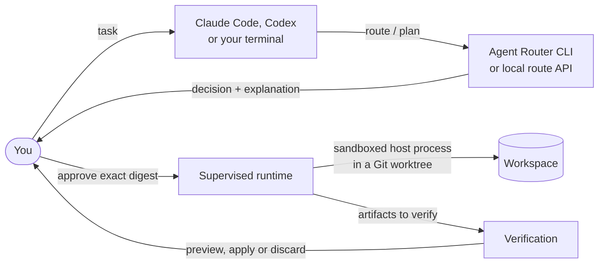
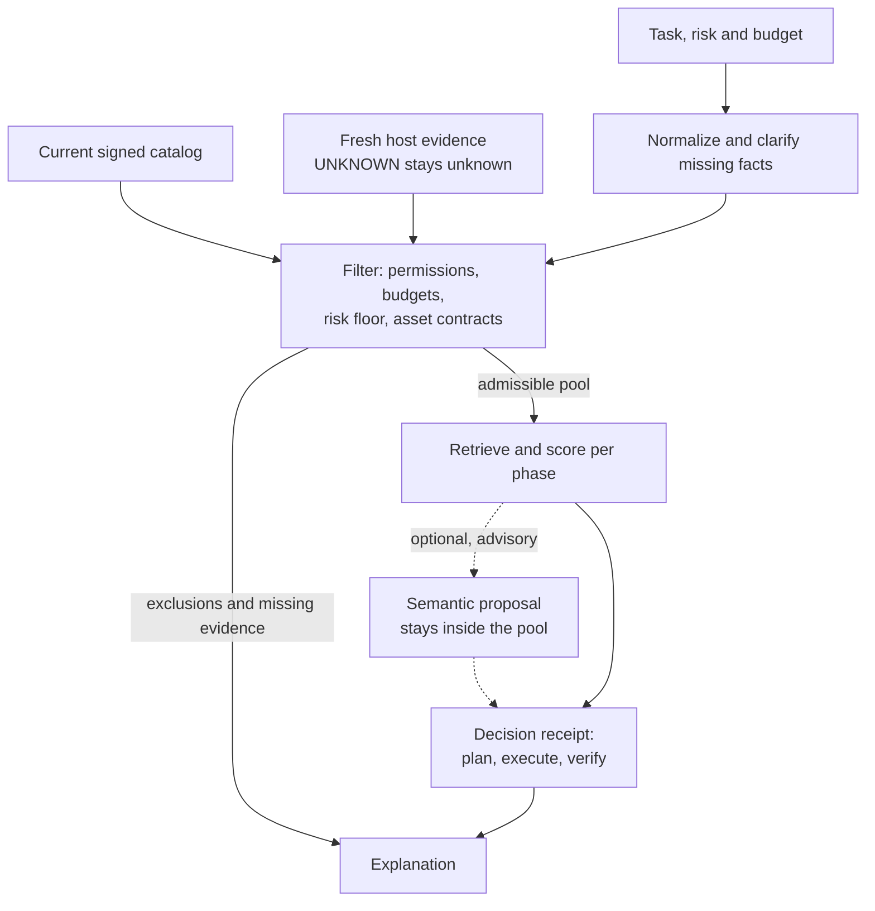
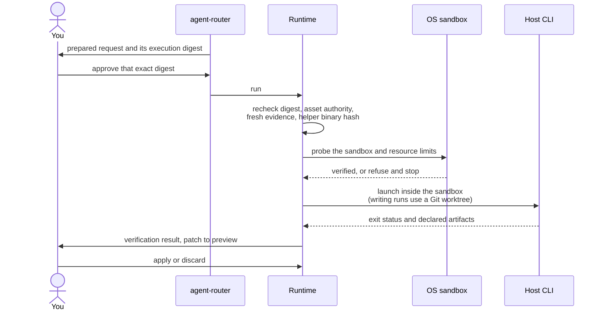

# Agent Router

**Choose the model, effort and skills for each coding task. Review the decision. Run an approved workflow.**

<table>
  <tr>
    <td width="64">
      <a href="https://www.florian.bruniaux.com/about/?utm_source=github&amp;utm_medium=readme&amp;utm_campaign=agent-router"></a>
    </td>
    <td>
      <strong><a href="https://www.florian.bruniaux.com/about/?utm_source=github&amp;utm_medium=readme&amp;utm_campaign=agent-router">Florian BRUNIAUX</a></strong> &middot; AI Founding Engineer @ <a href="https://methode-aristote.fr/">Méthode Aristote</a><br />
      <a href="https://www.florian.bruniaux.com/blog/?utm_source=github&amp;utm_medium=readme&amp;utm_campaign=agent-router">Blog &#8599;</a> &middot; <a href="https://www.florian.bruniaux.com/projects/?utm_source=github&amp;utm_medium=readme&amp;utm_campaign=agent-router">Projects &#8599;</a> &middot; <a href="https://github.com/FlorianBruniaux/ccboard">CCBoard</a>
    </td>
  </tr>
</table>

<p align="center">
  <a href="https://github.com/FlorianBruniaux/agent-router/actions/workflows/ci.yml"></a>
  <a href="https://github.com/FlorianBruniaux/agent-router/actions/workflows/runtime-linux.yml"></a>
  <a href="https://github.com/FlorianBruniaux/agent-router/actions/workflows/dependency-audit.yml"></a>
  <a href="rust-toolchain.toml"></a>
  <a href="licenses/LICENSE-MIT"></a>
  <a href="#host-support"></a>
</p>

<p align="center">
  <a href="#quick-start">Quick start</a> &middot;
  <a href="#features">Features</a> &middot;
  <a href="#how-it-works">How it works</a> &middot;
  <a href="#documentation">Documentation</a> &middot;
  <a href="https://github.com/FlorianBruniaux/agent-router/issues/11">Roadmap</a>
</p>

Agent Router is a local Rust CLI for routing coding work across models, agents,
skills and tools. It checks constraints before scoring, explains its choices,
and separates planning, execution and verification. Your coding host continues
to own its interaction, credentials and native permissions.

<p align="center">
  
</p>

<p align="center">
  <a href="docs/media/routing-demo.mp4">Watch the demo</a> &middot;
  <a href="docs/media/README.md">Commands and reproduction</a>
</p>

The demo uses bundled synthetic fixtures and actual CLI output. It makes no
model call. Model names in those fixtures are examples, not availability claims.

## What Agent Router is, and what it is not

| Agent Router is | Agent Router is not |
| --- | --- |
| A local decision layer: it picks the model, effort and skills for each phase of a coding task and explains why. | A coding agent. Your host (Claude Code, Codex, OpenCode, Copilot) still does the work. |
| Constraint-first: permissions, budgets, risk and missing evidence filter candidates before any score is computed. | A score-only ranker. A higher score never makes an inadmissible candidate valid. |
| Deterministic and replayable: the same inputs give the same decision, receipt and explanation. | A learned black box. Semantic proposals stay optional, advisory and inside the admissible pool. |
| Review before execution: a run needs an approved digest, fresh capability evidence and a verified OS sandbox. | An autonomous runner. It never bypasses a host's own permission system or runs with approvals turned off. |
| Explicit about uncertainty: unknown host capabilities, costs and identities stay `UNKNOWN`. | A source of claims it cannot prove. It does not report a gain, a support level or a model identity without evidence. |
| Local and offline for routing: no provider call, daemon or network access is needed to route. | A hosted gateway, a model proxy or a credential broker. No provider transport is wired into execution today. |
| A set of bounded Rust libraries plus one CLI, with versioned JSON contracts. | A package that installs hooks, skills or global configuration on your machine. |

## Features

| Capability | What you can do | Interface / guide |
| --- | --- | --- |
| **Explainable routing** | Select a model and effort for plan, execute and verify; inspect exclusions and missing evidence. | `route`, `route-phase`, `explain` |
| **Host evidence** | Read supported local host evidence and keep unknown capabilities explicit. | `inspect`, [contracts](docs/reference/json-contracts.md) |
| **Catalogs and search** | Search five asset families with BM25, contextual signals, deterministic rank fusion and checked incremental updates. | `catalog`, `index`, `search`, `refresh`, [retrieval](docs/retrieval.md) |
| **Signed asset preparation** | Validate the current catalog and publisher grants around assembly of the selected assets. Available through the library; signed CLI execution remains open work. | [Signed preparation](docs/signed-preparation.md) |
| **Workflow planning** | Apply a risk floor, clarify missing facts and build one of eight presets, then rank bounded global assignments under cumulative budgets. | `normalize`, `plan`, `workflow`, `generate-plan`, [plan generation](docs/plan-generation.md) |
| **Guided task intake** | Collect missing facts explicitly and export a complete task without granting implied permissions. | `task-guide`, [guided intake](docs/task-guide.md) |
| **Human and JSON output** | Read decisions and approvals in the terminal, or preserve full versioned results for scripts with `--json`. | [CLI output](docs/cli-output.md) |
| **Layered configuration** | Load strict JSON, TOML or YAML configuration layers while preserving restrictive precedence. | `config --layers`, [formats](docs/configuration-formats.md) |
| **Review before execution** | Prepare a request, bind selected assets and approve the exact execution digest. | `assets`, `prepare`, `run`, [execution](docs/cli-execution.md) |
| **Durable execution** | Track runs, cancel work, recover interrupted attempts and isolate writes in Git worktrees. | `status`, `cancel`, `events`, [runtime](docs/runtime.md) |
| **Shared capacity and session budgets** | Reserve capacity and conservative cost/token allocations across runtime roots; review additional allocation against the current ledger. | `admission`, `admission budget`, [budgets](docs/session-budgets.md) |
| **Coordinated workflows** | Run approved waves, pass declared artifacts and require verification before integration. | `coordinate`, [coordination](docs/coordinator.md) |
| **Explicit integration** | Preview, apply or discard a verified patch; control output retention and purge. | `artifacts`, [controls](docs/cli-execution.md) |
| **Evaluation and feedback** | Replay decisions, report success under budget and calibration on explicit cohorts, and retain consented feedback locally. | `replay`, `eval`, `feedback`, `policy` |
| **Optional semantic decisions** | Compare proposals in shadow, then review signed evidence, activate explicitly and revoke before dispatch. | `backend`, `backend-activation`, [execution binding](docs/backend-execution.md) |
| **Local ranking sidecar** | Compare bounded ranking proposals and explicitly send selected outcomes or feedback under current consent. | `sidecar`, [protocol and consent](docs/standard-sidecar.md) |
| **Diagnostics and audit** | Inspect configuration and active runtime storage without recovery; keep process and cleanup authority unknown, and export a redacted audit trail. | `doctor`, `audit`, [diagnostics](docs/doctor.md) |
| **Separate distributions** | Export source workspaces or build a local native binary with verified licenses, inventories and reproducibility checks. | [Distribution](docs/distribution.md) |
| **Dependency checks** | Verify source license evidence and audit the committed dependency lock against a fresh RustSec database in CI. | [License evidence](docs/distribution.md#continuous-integration-license-evidence-gate), [security audit](docs/dependency-audit.md) |
| **Local route-only API** | Serve route decisions over a private Unix socket with a token; no execution, feedback or activation endpoint. Opt-in build feature. | `serve` (`--features local-api`), [local API](docs/local-api.md) |
| **Verifiable local release** | Bind source and binary archives to a canonical manifest, verify an externally produced Ed25519 signature and render a Homebrew formula. It never signs, publishes or installs; the Homebrew install itself is not yet tested. | [Local release](docs/release-local.md) |

### Library building blocks, not yet wired into the CLI

| Capability | What it does | Guide |
| --- | --- | --- |
| **Advisory decision cache** | Stores backend proposals authenticated with HMAC; a cached entry is advice, never authority. | [ADR 0011](docs/adr/0011-advisory-decision-cache.md) |
| **Inert importer** | Turns a directory of Markdown agents and skills into an unsigned catalog candidate and a report; signs and activates nothing. | [Importer](docs/importer.md) |
| **Local vector ranking** | Ranks assets from caller-supplied fixed-point vectors in exact integer arithmetic, behind the `semantic-ranking` feature. | [Retrieval](docs/retrieval.md) |
| **Plan proposals** | Reviews a plan proposed by a model against the caller's task and limits, and reports its divergence from the baseline; never approves it. | [Plan proposals](docs/plan-proposals.md) |
| **Review separation** | Restricts producer to reviewer edges to distinct declared providers. | [Review separation](docs/review-separation.md) |
| **Structured validation** | Evaluates typed validation contracts over a caller-supplied view and returns a digest-bound report. | [Structured validation](docs/structured-validation.md) |
| **Adapter descriptors** | Validates `adapter.json` descriptors inertly: reserved names, bound entry points, no activation. | [Descriptor format](integrations/README.md) |
| **Multimodal contracts** | Types and bounds image, audio, file inputs and JSON outputs; nothing is transported. | [JSON contracts](docs/reference/json-contracts.md) |

The project is under active development. Human validation of the evaluation
corpus, the full startup target and additional native host evidence remain open.
See the [completion ledger](docs/completion.md) and [roadmap](https://github.com/FlorianBruniaux/agent-router/issues/11)
for acceptance criteria. Public release is still gated by license and security review.

## Quick start

### Build from source

The [installation guide](docs/install.md) covers prerequisites, optional build
features, the verifiable local release and uninstalling. Use Rust 1.85 or newer. The repository pins the development toolchain in
[`rust-toolchain.toml`](rust-toolchain.toml). Clone access is required while the
repository is private.

```sh
git clone git@github.com:FlorianBruniaux/agent-router.git
cd agent-router
cargo build --release --locked -p agent-router-cli -p router-sandbox-helper
./target/release/agent-router --help
```

The default CLI includes the Codex and Claude adapter features. To build the
routing CLI without those host adapters, use `--no-default-features`. Routing
works offline once Cargo dependencies are available; no Python or semantic
service is required at runtime. There is no published package-manager install
or automatic global configuration step.

### Route a task and read the explanation

These commands use the bundled example catalog and request. They only produce
a decision and explanation; they do not launch a host or call a model.

```sh
./target/release/agent-router route \
  --request tests/fixtures/requests/codex-implementation.json \
  --catalog assets/catalogs/codex-core-v1.json \
  --json > /tmp/agent-router-decision.json

./target/release/agent-router explain \
  --decision /tmp/agent-router-decision.json
```

For that fixture, the explanation includes:

```text
Preset: plan-execute-verify
Plan: gpt-5.6-sol/high -> gpt-5.6-terra/medium -> gpt-5.6-terra/high
Excluded candidates: 13
Missing evidence: 0
```

For phase-specific routing, try the synthetic observed-host fixture:

```sh
./target/release/agent-router route-phase \
  --context fixtures/examples/phase-request.json \
  --host-snapshot fixtures/examples/phase-snapshot.json \
  --catalog fixtures/examples/phase-catalog.json \
  --now 100 --json
```

`--now 100` is only for the fixture's clock. Real host evidence must be fresh.
Most product commands expose stable machine output through `--json`; run
`agent-router <command> --help` for the required inputs. `route` exits `0` for a
selection, `3` for a valid no-route result, `2` for invalid input and `4` for an
internal error.

### Run an approved workflow

Follow the [preparation guide](docs/preparation.md), then the
[single-run guide](docs/cli-execution.md) or [workflow guide](docs/coordinator.md).
Execution requires current asset authority, a reviewed digest, explicit storage
and a working native sandbox. A successful process exit is separate from
verification of the task's result.

## How it works

### Where it sits

You keep working in your coding host or terminal. Agent Router answers one
question, which model, effort and skills for each phase, and hands back a
decision you can read before anything runs.



### How a decision is made

Constraints come first. Scoring only ranks candidates that are already
admissible, and every exclusion is kept in the explanation.



### What must hold before anything runs

Routing and preparation never execute anything. A run starts only when every
check passes at launch time.



The deterministic receipt records the decision and its evidence. An optional
semantic proposal stays within the admissible candidate pool. Unknown
permissions or incompatible assets cannot become valid through a higher score.
Execution binds the request, binary, sandbox and asset contracts to an approval.
Later workflow steps receive only declared, bounded artifacts.

## Host support

| Host / platform | Current evidence and boundary |
| --- | --- |
| **Codex** | CLI adapter, passive model-cache inspection and native stream decoding. Requested model identity remains separate from observed identity. |
| **Claude Code** | CLI adapter and explicit native-stream inspection. Missing model or effort evidence remains unknown. |
| **OpenCode / Copilot** | Optional CLI adapters with approved configuration and isolated version probes. Protocol fixtures and fake-host sandbox canaries are tested; native installations and providers remain unverified. [Setup and limits](docs/other-hosts.md). |
| **Other hosts** | Integration descriptors and synthetic conformance fixtures are available. [Integration status](integrations/additional-hosts.md) records remaining native proof. |
| **Omnigent** | Offline routing translation with strict offered-pair and local eligibility checks. No HTTP endpoint or native session integration yet. [Contract and limits](integrations/omnigent.md). |
| **macOS** | Seatbelt supervisor and real local sandbox/recovery canaries. Process-group cleanup does not establish containment of detached descendants. |
| **Linux** | Bubblewrap supervisor with PID namespace cleanup, exercised by [native runtime CI](https://github.com/FlorianBruniaux/agent-router/actions/workflows/runtime-linux.yml). |
| **Windows** | Native execution is not implemented. |

Host CLIs and credentials are supplied separately. Agent Router does not
silently install them, bypass their permission systems or change the model of
an existing parent conversation.

## Documentation

| Start here | Go deeper |
| --- | --- |
| [Install Agent Router](docs/install.md) | [Changelog](CHANGELOG.md) |
| [Serve the local route API](docs/local-api.md) | [Build a verifiable local release](docs/release-local.md) |
| [Prepare an execution](docs/preparation.md) | [Asset contracts and trust](docs/asset-contracts.md) |
| [Run, verify and retain outputs](docs/cli-execution.md) | [Runtime and crash recovery](docs/runtime.md) |
| [Coordinate a workflow](docs/coordinator.md) | [JSON contracts](docs/reference/json-contracts.md) |
| [Generate bounded plans](docs/plan-generation.md) | [Durable escalation library](docs/escalation.md) |
| [Search catalogs](docs/retrieval.md) | [Routing architecture](docs/adr/0002-bounded-routing-pipeline.md) |
| [Validate signed catalogs](docs/signed-catalogs.md) | [Omnigent comparison and roadmap](docs/omnigent-comparison.md) |
| [Evaluate decisions](docs/evaluation.md) | [Private feedback and offline policy](docs/feedback.md) |
| [Execute signed backend decisions](docs/backend-execution.md) | [Activation and rollback](docs/backend-store.md) |
| [Inspect diagnostics](docs/doctor.md) | [Performance measurements](docs/performance.md) |
| [Build source distributions](docs/distribution.md) | [Build a local native binary](docs/binary-distribution.md) |
| [Review shared session budgets](docs/session-budgets.md) | [Development harness](docs/harness.md) |

The [functional specification](docs/specs/functional-specification.md) and
[technical specification](docs/specs/technical-specification.md) define the wider
project. The [completion ledger](docs/completion.md) distinguishes delivered
behavior from outstanding acceptance.

## Development

```sh
cargo fmt --all -- --check
cargo clippy --workspace --all-targets --all-features --locked -- -D warnings
cargo test --workspace --locked
cargo run -p xtask --locked -- check
```

Native sandbox canaries are separate from the ordinary test suite and require
their platform prerequisites. See [runtime verification](docs/runtime.md).
The shared Codex/Claude development harness is separate from the product.
No global instructions, hooks or skills are installed by these commands.

Use the [issue tracker](https://github.com/FlorianBruniaux/agent-router/issues)
for bugs and feature requests. Include the command, version, platform and a
redacted reproduction. Keep credentials, prompts and private policy data out
of reports.

## License

The project is licensed under [MIT](licenses/LICENSE-MIT) or
[Apache 2.0](licenses/LICENSE-APACHE), at your option. Dependency provenance,
license inventory and release review boundaries are documented in the
[distribution guide](docs/distribution.md).
