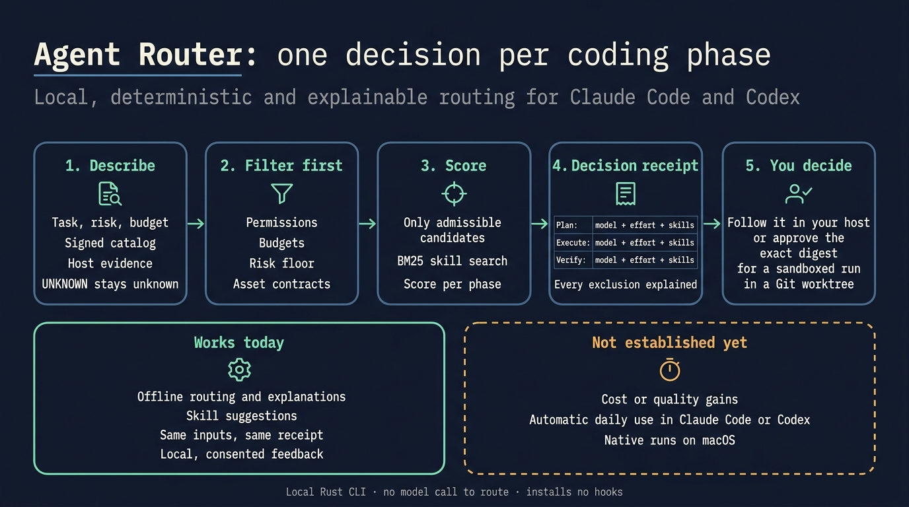
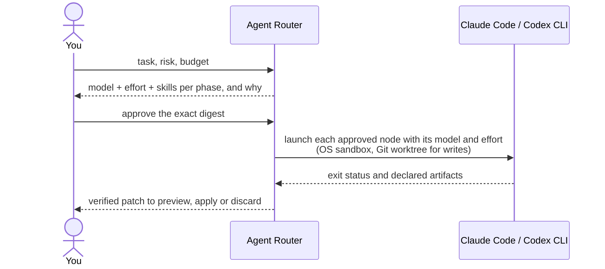
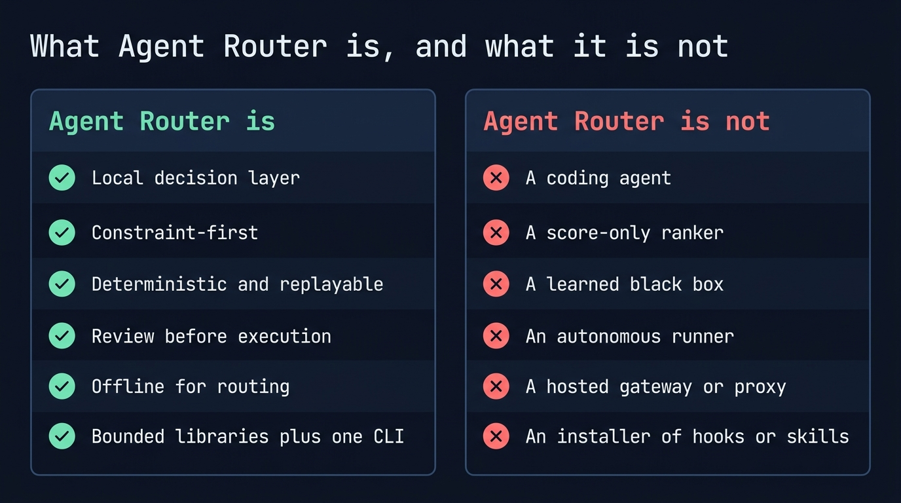
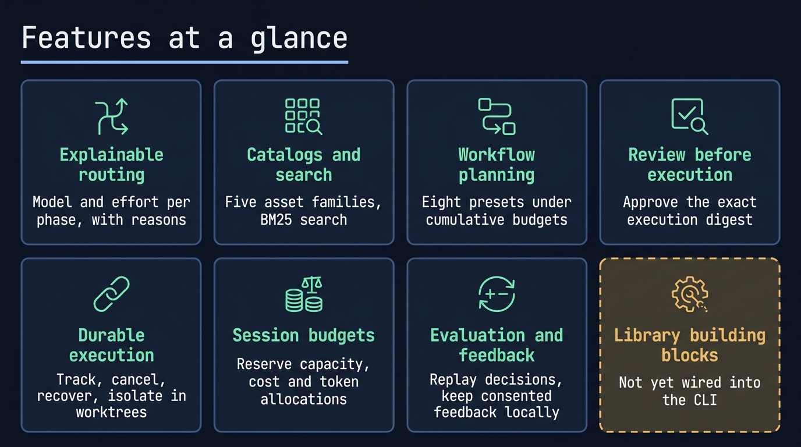
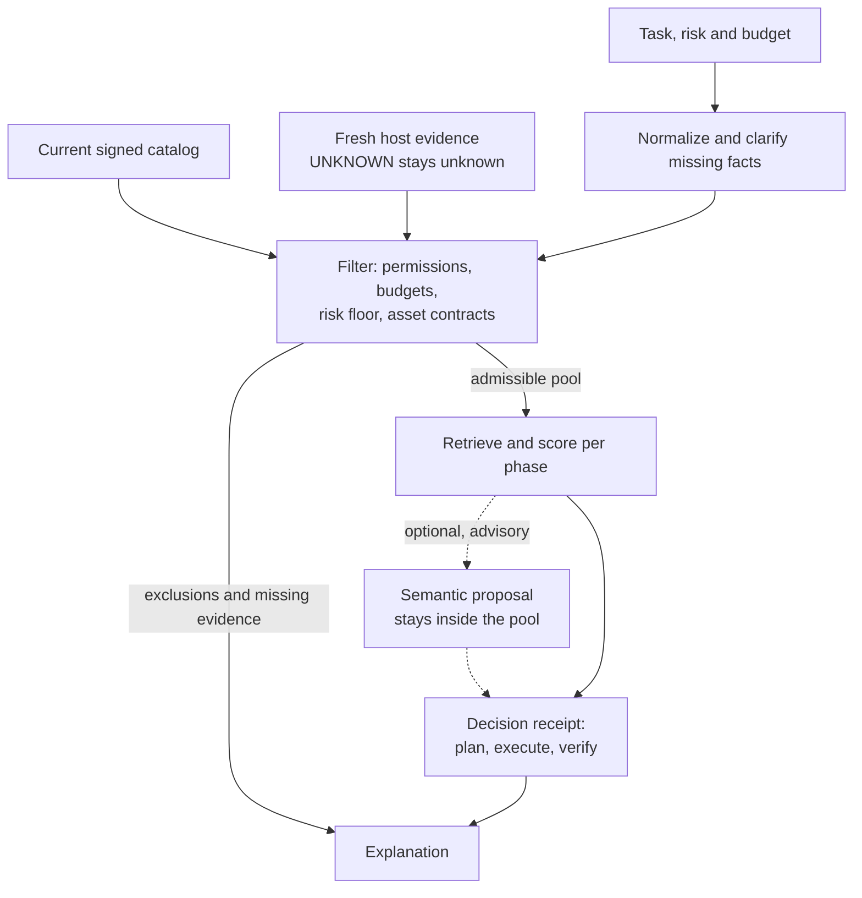
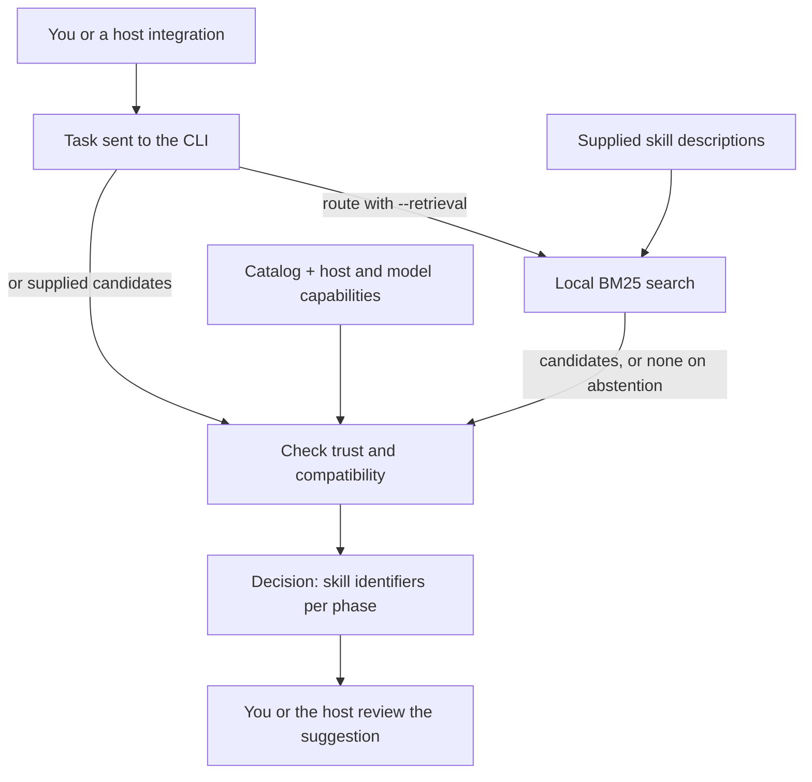
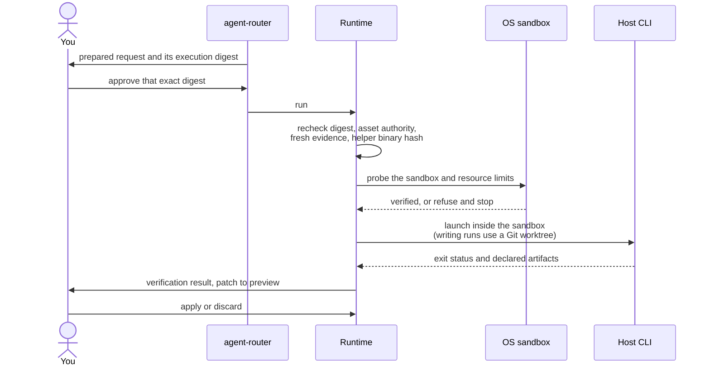

# Agent Router

**Choose model, effort and skills for each coding phase.**

Experimental, local and explainable routing for Claude Code and Codex.

<table>
  <tr>
    <td width="64">
      <a href="https://www.florian.bruniaux.com/about/?utm_source=github&amp;utm_medium=readme&amp;utm_campaign=agent-router"></a>
    </td>
    <td>
      <strong><a href="https://www.florian.bruniaux.com/about/?utm_source=github&amp;utm_medium=readme&amp;utm_campaign=agent-router">Florian BRUNIAUX</a></strong> &middot; AI Founding Engineer @ <a href="https://methode-aristote.fr/">Méthode Aristote</a><br />
      <a href="https://www.florian.bruniaux.com/blog/?utm_source=github&amp;utm_medium=readme&amp;utm_campaign=agent-router">Blog &#8599;</a> &middot; <a href="https://www.florian.bruniaux.com/projects/?utm_source=github&amp;utm_medium=readme&amp;utm_campaign=agent-router">Projects &#8599;</a> &middot; <a href="https://github.com/FlorianBruniaux/ccboard">CCBoard</a>
    </td>
  </tr>
</table>

---

<p align="center">
  <a href="https://github.com/FlorianBruniaux/agent-router/actions/workflows/ci.yml"></a>
  <a href="https://github.com/FlorianBruniaux/agent-router/actions/workflows/runtime-linux.yml"></a>
  <a href="https://github.com/FlorianBruniaux/agent-router/actions/workflows/dependency-audit.yml"></a>
  <a href="rust-toolchain.toml"></a>
  <a href="LICENSE.md"></a>
  <a href="#host-support"></a>
</p>

<p align="center">
  <a href="#why-it-exists">Why</a> &middot;
  <a href="#project-status">Status</a> &middot;
  <a href="#quick-start">Quick start</a> &middot;
  <a href="#features">Features</a> &middot;
  <a href="#how-it-works">How it works</a> &middot;
  <a href="#host-support">Host support</a> &middot;
  <a href="#documentation">Documentation</a> &middot;
  <a href="https://github.com/FlorianBruniaux/agent-router/issues/11">Roadmap</a>
  <br />
  English | <a href="README.fr.md">Français</a>
</p>

---

Agent Router is a local Rust CLI for routing coding work across models, agents,
skills and tools. It checks constraints before scoring, explains its choices,
and separates planning, execution and verification. Your coding host continues
to own its interaction, credentials and native permissions.

<!-- infographic:overview -->
<p align="center"></p>
<!-- /infographic:overview -->

<p align="center">
  
</p>

<p align="center">
  <a href="docs/media/routing-demo.mp4">Watch the demo</a> &middot;
  <a href="docs/media/README.md">Commands and reproduction</a>
</p>

The demo uses bundled synthetic fixtures and actual CLI output. It makes no
model call. Model names in those fixtures are examples, not availability claims.

---

## Why it exists

A coding host such as Claude Code or Codex uses one model and
effort setting per session unless you switch by hand. Picking a stronger model
for planning, a cheaper one for a routine edit, or the right skills for the task
is left to habit. Nothing records why a choice was made, and permission or
budget limits may only show up once the agent is already working.

**What you get.**

- **A choice per phase**: plan, execute and verify can each get their own model,
  effort and skills, instead of one default for everything.
- **Limits checked first**: permissions, budget, risk and missing host evidence
  remove candidates before any score is computed.
- **A decision you can read**: every choice and every exclusion is explained,
  and the same inputs replay to the same receipt.
- **Nothing runs unapproved**: you approve one exact digest; the run is
  sandboxed, any write goes to a Git worktree, and you preview the patch before
  applying it.

No general cost or quality gain is established. The [host-direct pilot](docs/bench/playbook.md#conclusions-of-the-full-run)
reports results on 10 small Python tasks with one repetition; it does not exercise
the Agent Router supervised runtime or validate automatic daily host integration.



You call Agent Router from a terminal, or from a host through the opt-in local
route API. It does not switch the model of the conversation you are in: each
approved phase runs as a separate host process.

---

## What Agent Router is, and what it is not

Agent Router is a local, deterministic decision layer: it picks the model, effort and skills for each phase of a coding task and explains why. It is not a coding agent, a hosted gateway or an autonomous runner; your host still does the work.

<!-- infographic:is-isnt -->
<p align="center"></p>
<!-- /infographic:is-isnt -->

<details>
<summary>Show the full "is / is not" table</summary>

| Agent Router is | Agent Router is not |
| --- | --- |
| A local decision layer: it picks the model, effort and skills for each phase of a coding task and explains why. | A coding agent. Your host (Claude Code, Codex, OpenCode, Copilot) still does the work. |
| Constraint-first: permissions, budgets, risk and missing evidence filter candidates before any score is computed. | A score-only ranker. A higher score never makes an inadmissible candidate valid. |
| Deterministic and replayable: the same inputs give the same decision, receipt and explanation. | A learned black box. Semantic proposals stay optional, advisory and inside the admissible pool. |
| Review before execution: a run needs an approved digest, fresh capability evidence and a verified OS sandbox. | An autonomous runner. It never bypasses a host's own permission system or runs with approvals turned off. |
| Explicit about uncertainty: unknown host capabilities, costs and identities stay `UNKNOWN`. | A source of claims it cannot prove. It does not report a gain, a support level or a model identity without evidence. |
| Local and offline for routing: no provider call, daemon or network access is needed to route. | A hosted gateway, a model proxy or a credential broker. Host or explicit parent configuration owns provider access; offline routing makes no provider call. |
| A set of bounded Rust libraries plus one CLI, with versioned JSON contracts. | A package that installs hooks, skills or global configuration on your machine. |

</details>

---

## Project status

Status, 2026-10-27: **offline routing works; automatic daily Claude/Codex use
remains unqualified.** The checks below describe different evidence scopes.

| Surface | What is verified | Remaining limit |
| --- | --- | --- |
| Offline routing | Model, effort and skill selection, constraint filtering and repeatable explanations on bundled fixtures. | Fixture declarations do not prove live model availability. Try the [offline test](#route-a-task-and-read-the-explanation). |
| Finite native execution | Pinned Linux ARM64 runs with the real Codex client, scripted responses, an actual permission refusal and a captured patch passing 18 public checks. | No real model or provider account in these runs. [Complete parent evidence](docs/bench/fresh-finite-entry-2026-10-22/README.md#follow-up-one-complete-fresh-parent-flow). |
| Private application and resume | Explicit candidate application and five pinned native resume cases, including refusal after partial writes or later edits. | Writes are not crash-atomic. The later inline-diff presentation change (#211) has local tests but no replay of its five composed Linux cases. [Resume evidence](docs/bench/native-application-resume-2026-10-24/README.md). |
| Finite context tools, T1–T4 | Exact line windows, opt-in terminal SGR views, complete raw recall, explicit policy and an authored offline corpus. | Context-v4 native Linux ARM64 qualification is **NOT RUN**; the SDK-normalized catalogue hash is **UNKNOWN**. The corpus delivers **415 more JSON bytes**, rereads included. [Context results](docs/bench/rtk-context-offline/README.md). |
| Outcomes and costs | The [assisted M4 trial produced an accepted correction](docs/bench/m4-fix-integration-2026-10-11.md); supplied usage can feed accepted-revision cost calculation. | Missing monetary totals remain unknown. No general savings or quality gain is established. [Retained M4 evidence](docs/bench/accepted-evidence-2026-10-15/README.md). |

Source quality checks and the extracted source archive passed locally for the
code merged in #195 (`492c956`). Hosted checks run on every push and pull
request since the repository became public on 2026-10-28; the badges above
show their current result.
Native records above bind their own source and binary hashes, not every later
change. Linux qualifications retain 8 GiB, zero swap and their private-access
boundaries. Native macOS admission remains blocked by the
[8 GiB address-space limit](docs/bench/macos-memory-followup-2026-10-11/README.md).

The `finite-entry` command uses an explicit local scripted parent; it is not an
automatic hook for your current conversation. `finite-resume` can finish an
eligible interrupted application without starting another worker. These
commands require their documented configuration and authority; the quick test
below only routes. [Fresh entry protocol](docs/bench/fresh-finite-entry-2026-10-22/README.md)
and [resume protocol](docs/reference/finite-application-resume.md).

[Passive observation](docs/run-observation.md),
[evaluator qualification](docs/evaluator-qualification.md) and
[supplied usage pricing](docs/supplied-usage-pricing.md) remain available with
their stated evidence limits. No hook or global host configuration is installed
by this repository's build commands.

This source-available candidate uses [FSL-1.1-ALv2](LICENSE.md), with future
Apache 2.0 conversion. Start with the [quick test](#quick-start).
The [experimental onboarding](docs/experimental-release.md) retains historical
installation evidence; the dated status above records subsequent integration.

---

## Quick start

Start from an authorized checkout of this development repository. The
[public core snapshot](https://github.com/FlorianBruniaux/agent-router-core)
was published separately on 2026-10-22; its README and `DISTRIBUTION.json`
describe that snapshot, which is not automatically synchronized with this tree.
No public tap, crates.io package or signed release asset is announced here.

The test below builds only the routing CLI, then selects and explains a plan.
It needs no model, host login, daemon, helper or global configuration.

### Build from source

The [installation guide](docs/install.md) covers prerequisites, optional build
features, the verifiable local release and uninstalling. Use Rust 1.85 or newer. The repository pins the development toolchain in
[`rust-toolchain.toml`](rust-toolchain.toml). Clone access is required while the
development repository is private; the public core snapshot is a separate distribution.

```sh
git clone https://github.com/FlorianBruniaux/agent-router.git
cd agent-router
cargo build --locked -p agent-router-cli
./target/debug/agent-router version --json
```

`version --json` reports this build; it does not inspect or launch a host.
Cargo may fetch locked dependencies during compilation. With a populated
cache, add `--offline` to the build command.

<details>
<summary>Build options and limits</summary>

The default CLI includes the Codex and Claude adapter features. To build the
routing CLI without those host adapters, use `--no-default-features`. Routing
works offline once Cargo dependencies are available; no Python or semantic
service is required at runtime. Cargo's pinned Git channel builds source;
Homebrew uses an explicitly generated local formula. Installation performs no
automatic global host configuration.

</details>

### Route a task and read the explanation

These commands use the bundled example catalog and request. They only produce
a decision and explanation; they do not launch a host or call a model.
Model names and capability declarations in these synthetic fixtures are not
evidence of current model availability, authentication or native host support.

```sh
example_dir=$(mktemp -d)
./target/debug/agent-router route \
  --request tests/fixtures/requests/codex-implementation.json \
  --catalog assets/catalogs/codex-core-v1.json \
  --json > "$example_dir/decision.json"

./target/debug/agent-router explain \
  --decision "$example_dir/decision.json"
```

Both commands should exit `0`. For that fixture, the explanation includes:

```text
Preset: plan-execute-verify
Plan: gpt-5.6-sol/high -> gpt-5.6-terra/medium -> gpt-5.6-terra/high
Excluded candidates: 13
Missing evidence: 0
```

`Missing evidence: 0` refers to supplied fixture data. This test does not
implement a task or prove current model support. Keep `example_dir` to inspect
the decision, or remove only that file and directory when finished.

For Claude Code, use the operator-declared `claude-core-v1` catalog. It rates
no model, so the plan below is a deterministic tie-break among unrated entries,
not a quality judgement:

```sh
./target/debug/agent-router route \
  --request tests/fixtures/requests/claude-implementation.json \
  --catalog assets/catalogs/claude-core-v1.json \
  --json > "$example_dir/claude-decision.json"

./target/debug/agent-router explain \
  --decision "$example_dir/claude-decision.json"
```

```text
Preset: plan-execute-verify
Plan: claude-opus-5-5/high -> claude-opus-5-5/high -> claude-opus-5-5/high
Excluded candidates: 22
Missing evidence: 0
```

See [the catalog notes](assets/catalogs/README.md) for what this catalog does
not establish.

### Describe your own task

```sh
./target/debug/agent-router task-guide \
  --text 'Fix a Rust parser and verify its tests' --json
```

Expected result: `status: needs_clarification`, exit `3`. This is a request for
missing facts, not a failed model call. Add `--interactive` to answer the
questions about task kind, scope, risk, permissions, acceptance and budget.
The [guided intake](docs/task-guide.md) prepares task facts; it grants no
execution authority and calls no model.

### Get advice for that task

Once the task is complete, `advise` maps it to a route request and returns a
model, effort and skills recommendation per phase, or an explained refusal,
ending with the next manual action for your host. It is Codex first, advisory
only and executes nothing. Follow the [advisory route guide](docs/advisory-route.md),
which also covers the case where unknown tool support blocks every model.

<details>
<summary>Phase-specific routing and exit codes</summary>

`route-phase` validates host capability evidence. The historical
`fixtures/examples/phase-snapshot.json` is not authenticated for current
capability claims and is refused with `capability.evidence.unauthenticated`;
setting `--now 100` does not authenticate it. For the current proof contract,
see [host capability evidence](docs/adr/0021-host-capability-evidence.md).
Use the `route` fixture above for the self-contained offline test.

Most product commands expose stable machine output through `--json`; run
`agent-router <command> --help` for the required inputs. `route` exits `0` for a
selection, `3` for a valid no-route result, `2` for invalid input, `4` for an
internal error and `7` for an integrity error; see
[exit codes](docs/cli-output.md#exit-codes-and-error-codes).

</details>

### Run an approved workflow

This is a separate path from the offline test. Build `router-sandbox-helper`
separately and configure its exact path/hash for supervised execution.
[Pinned Cargo installation](docs/install.md#cargo-from-a-pinned-git-revision)
and the [local Homebrew formula](docs/install.md#homebrew-local-formula) cover
the two-binary distribution.

Follow the [preparation guide](docs/preparation.md), then the
[single-run guide](docs/cli-execution.md) or [workflow guide](docs/coordinator.md).
Execution requires current asset authority, a reviewed digest, explicit storage
and a working native sandbox. A successful process exit is separate from
verification of the task's result.

---

## Features

- **Route and explain**: select a model and effort for plan, execute and verify, and inspect exclusions and missing evidence (`route`, `route-phase`, `explain`, `inspect`).
- **Catalogs and search**: search five asset families with BM25, contextual signals, deterministic rank fusion and checked incremental updates (`catalog`, `index`, `search`, `refresh`). Signed asset preparation is available through the library; signed CLI execution remains open work.
- **Plan and intake**: apply a risk floor, build one of eight presets and rank bounded global assignments under cumulative budgets; collect missing facts with guided task intake (`normalize`, `plan`, `workflow`, `generate-plan`, `task-guide`).
- **Review before execution**: prepare a request, bind selected assets and approve the exact execution digest (`assets`, `prepare`, `run`).
- **Durable, coordinated execution**: track runs, cancel, recover and isolate writes in Git worktrees; run approved waves; preview, apply or discard a verified patch; reserve shared capacity and session budgets.
- **Evaluate and optional semantics**: replay decisions, evaluate explicit cohorts and retain consented feedback locally; compare optional semantic proposals and local ranking sidecar outcomes (`replay`, `eval`, `feedback`, `policy`, `backend`, `sidecar`).
- **Output, configuration and diagnostics**: human and `--json` output, layered configuration, `doctor` and a redacted `audit` trail.
- **Distribution and release**: a native CLI plus sandbox helper, pinned Cargo installation, a local Homebrew formula and verifiable release bindings. Public packages are not announced; [qualification](docs/bench/distribution-qualification-2026-10-07.md) records the channel evidence.

<!-- infographic:features -->
<p align="center"></p>
<!-- /infographic:features -->

<details>
<summary>Full capability table</summary>

| Capability | What you can do | Interface / guide |
| --- | --- | --- |
| **Explainable routing** | Select a model and effort for plan, execute and verify; inspect exclusions and missing evidence. | `route`, `route-phase`, `explain` |
| **Host evidence** | Read supported local host evidence and keep unknown capabilities explicit. | `inspect`, [contracts](docs/reference/json-contracts.md) |
| **Catalogs and search** | Search five asset families with BM25, contextual signals, deterministic rank fusion and checked incremental updates. | `catalog`, `index`, `search`, `refresh`, [retrieval](docs/retrieval.md) |
| **Signed asset preparation** | Validate the current catalog and publisher grants around assembly of the selected assets. Available through the library; signed CLI execution remains open work. | [Signed preparation](docs/signed-preparation.md) |
| **Workflow planning** | Apply a risk floor, clarify missing facts and build one of eight presets, then rank bounded global assignments under cumulative budgets. | `normalize`, `plan`, `workflow`, `generate-plan`, [plan generation](docs/plan-generation.md) |
| **Guided task intake** | Collect missing facts explicitly and export a complete task without granting implied permissions. | `task-guide`, [guided intake](docs/task-guide.md) |
| **Human and JSON output** | Read decisions and approvals in the terminal, or preserve full versioned results for scripts with `--json`. | [CLI output](docs/cli-output.md) |
| **Layered configuration** | Load strict JSON, TOML or YAML configuration layers while preserving restrictive precedence. | `config --layers`, [formats](docs/configuration-formats.md) |
| **Review before execution** | Prepare a request, bind selected assets and approve the exact execution digest. | `assets`, `prepare`, `run`, [execution](docs/cli-execution.md) |
| **Durable execution** | Track runs, cancel work, recover interrupted attempts and isolate writes in Git worktrees. | `status`, `cancel`, `events`, [runtime](docs/runtime.md) |
| **Shared capacity and session budgets** | Reserve capacity and conservative cost/token allocations across runtime roots; review additional allocation against the current ledger. | `admission`, `admission budget`, [budgets](docs/session-budgets.md) |
| **Coordinated workflows** | Run approved waves, pass declared artifacts and require verification before integration. | `coordinate`, [coordination](docs/coordinator.md) |
| **Explicit integration** | Preview, apply or discard a verified patch; control output retention and purge. | `artifacts`, [controls](docs/cli-execution.md) |
| **Evaluation and feedback** | Replay decisions, report success under budget and calibration on explicit cohorts, and retain consented feedback locally. | `replay`, `eval`, `feedback`, `policy` |
| **Optional semantic decisions** | Compare proposals in shadow, then review signed evidence, activate explicitly and revoke before dispatch. | `backend`, `backend-activation`, [execution binding](docs/backend-execution.md) |
| **Local ranking sidecar** | Compare bounded ranking proposals and explicitly send selected outcomes or feedback under current consent. | `sidecar`, [protocol and consent](docs/standard-sidecar.md) |
| **Diagnostics and audit** | Inspect configuration and active runtime storage without recovery; keep process and cleanup authority unknown, and export a redacted audit trail. | `doctor`, `audit`, [diagnostics](docs/doctor.md) |
| **Programmatic callers** | Print the JSON Schema of an output contract, report the build and supported contract versions as JSON, summarize feedback in one global total, and generate shell completions. | `schema`, `version --json`, `feedback summary`, `completions`, [CLI output](docs/cli-output.md#commands-for-programmatic-callers) |
| **Separate distributions** | Export source workspaces or build the default Claude/Codex CLI and sandbox helper with license inventories and two-build reproducibility checks. | [Distribution](docs/distribution.md), [binary export](docs/binary-distribution.md) |
| **Dependency checks** | Verify source license evidence and audit the committed dependency lock against a fresh RustSec database in CI. | [License evidence](docs/distribution.md#continuous-integration-license-evidence-gate), [security audit](docs/dependency-audit.md) |
| **Local route-only API** | Serve route decisions over a private Unix socket with a token; no execution, feedback or activation endpoint. Opt-in build feature. | `serve` (`--features local-api`), [local API](docs/local-api.md) |
| **Verifiable local release** | Bind both binaries to a v2 manifest, verify an external Ed25519 signature and render a local or canonical HTTPS Homebrew formula. Rendering does not sign, publish, install or establish remote asset availability. | [Local release](docs/release-local.md) |

</details>

<details>
<summary>Library building blocks, not yet wired into the CLI</summary>

| Capability | What it does | Guide |
| --- | --- | --- |
| **Advisory decision cache** | Stores backend proposals authenticated with HMAC; a cached entry is advice, never authority. | [ADR 0011](docs/adr/0011-advisory-decision-cache.md) |
| **Inert importer** | Turns a directory of Markdown agents and skills into an unsigned catalog candidate and a report; signs and activates nothing. | [Importer](docs/importer.md) |
| **Local vector ranking** | Ranks assets from caller-supplied fixed-point vectors in exact integer arithmetic, behind the `semantic-ranking` feature. | [Retrieval](docs/retrieval.md) |
| **Plan proposals** | Reviews a plan proposed by a model against the caller's task and limits, and reports its divergence from the baseline; never approves it. | [Plan proposals](docs/plan-proposals.md) |
| **Review separation** | Restricts producer to reviewer edges to distinct declared providers. | [Review separation](docs/review-separation.md) |
| **Structured validation** | Evaluates typed validation contracts over a caller-supplied view and returns a digest-bound report. | [Structured validation](docs/structured-validation.md) |
| **Adapter descriptors** | Validates `adapter.json` descriptors inertly: reserved names, bound entry points, no activation. | [Descriptor format](integrations/README.md) |
| **Multimodal contracts** | Types and bounds image, audio, file inputs and JSON outputs; nothing is transported. | [JSON contracts](docs/reference/json-contracts.md) |

</details>

The project is under active development. Human validation of the evaluation
corpus, the full startup target and additional native host evidence remain open.
See the [completion ledger](docs/completion.md) and [roadmap](https://github.com/FlorianBruniaux/agent-router/issues/11)
for acceptance criteria. This is an experimental source candidate; publication
still requires the release review and does not imply production readiness.

---

## How it works

The deterministic receipt records the decision and its evidence. An optional
semantic proposal stays within the admissible candidate pool. Unknown
permissions or incompatible assets cannot become valid through a higher score.
Execution binds the request, binary, sandbox and asset contracts to an approval.
Later workflow steps receive only declared, bounded artifacts.

### Where it sits

You keep working in your coding host or terminal. Agent Router answers one
question, which model, effort and skills for each phase, and hands back a
decision you can read before anything runs.

<details>
<summary>Open diagram: where it sits</summary>


</details>

### How a decision is made

Constraints come first. Scoring only ranks candidates that are already
admissible, and every exclusion is kept in the explanation.

<details>
<summary>Open diagram: how a decision is made</summary>



</details>

### How skills are suggested

A skill is a set of instructions that guides work, such as a testing method.
You, or an integration in your coding host, supply the task and skill
descriptions. Local search matches task words against those descriptions; the
router then checks candidates against the catalog, task, host and selected model.



Suggestion does not read skill bodies. Verified body loading belongs to the
separate preparation path, with its own required inputs and checks. Agent Router
installs no hook and does not automatically scan your Claude or Codex directories.
Without `--retrieval`, `route` uses candidates supplied in the request. The
[skill selection guide](docs/skill-selection.md) (FR) covers use cases,
abstention and a reproducible offline example.

### What must hold before anything runs

Routing and preparation never execute anything. A run starts only when every
check passes at launch time.

<details>
<summary>Open diagram: what must hold before anything runs</summary>



</details>

---

## Host support

Codex and Claude Code have CLI adapters; OpenCode and Copilot are optional adapters whose native installations and providers remain unverified. Runtime supervision exists on macOS (Seatbelt) and Linux (Bubblewrap); Windows native execution is not implemented.

<details>
<summary>Host and platform evidence table</summary>

| Host / platform | Current evidence and boundary |
| --- | --- |
| **Codex** | CLI adapter, passive model-cache inspection and native stream decoding. Requested model identity remains separate from observed identity. |
| **Claude Code** | CLI adapter and explicit native-stream inspection. Missing model or effort evidence remains unknown. |
| **OpenCode / Copilot** | Optional CLI adapters with approved configuration and isolated version probes. Protocol fixtures and fake-host sandbox canaries are tested; native installations and providers remain unverified. [Setup and limits](docs/other-hosts.md). |
| **Other hosts** | Integration descriptors and synthetic conformance fixtures are available. [Integration status](integrations/additional-hosts.md) records remaining native proof. |
| **Omnigent** | Offline routing translation with strict offered-pair and local eligibility checks. No HTTP endpoint or native session integration yet. [Contract and limits](integrations/omnigent.md). |
| **macOS** | Seatbelt supervisor and real local sandbox/recovery canaries. Process-group cleanup does not establish containment of detached descendants. |
| **Linux** | Bubblewrap supervisor with PID namespace cleanup; pinned ARM64 finite Codex runs and private application/resume evidence are linked in the dated status above. Historical native evidence is separate from current hosted CI, which did not start for `492c956`. |
| **Windows** | Native execution is not implemented. |

</details>

Host CLIs and credentials are supplied separately. Agent Router does not
silently install them, bypass their permission systems or change the model of
an existing parent conversation.

Automatic prompt interception and daily Claude/Codex integration remain
unvalidated. The [Codex app-server diagnostic](docs/bench/native-integration-u02/README.md)
observed explicit turn parameters and scripted output in a disposable client;
it was not an installed Agent Router integration or a real model inference.

---

## Documentation

The [full documentation index](docs/README.md) lists every guide by task. The most used ones are below.

<details>
<summary>Documentation index</summary>

| Start here | Go deeper |
| --- | --- |
| [Try the experimental offline surface](docs/experimental-release.md) | [Host integration evidence](docs/bench/native-integration-u02/README.md) |
| [Install Agent Router](docs/install.md) | [Changelog](CHANGELOG.md) |
| [Serve the local route API](docs/local-api.md) | [Build a verifiable local release](docs/release-local.md) |
| [Prepare an execution](docs/preparation.md) | [Asset contracts and trust](docs/asset-contracts.md) |
| [Run, verify and retain outputs](docs/cli-execution.md) | [Runtime and crash recovery](docs/runtime.md) |
| [Coordinate a workflow](docs/coordinator.md) | [JSON contracts](docs/reference/json-contracts.md) |
| [Generate bounded plans](docs/plan-generation.md) | [Durable escalation library](docs/escalation.md) |
| [Search catalogs](docs/retrieval.md) | [Routing architecture](docs/adr/0002-bounded-routing-pipeline.md) |
| [Validate signed catalogs](docs/signed-catalogs.md) | [Comparison with similar projects](docs/comparison.md), [Omnigent comparison and roadmap](docs/omnigent-comparison.md) |
| [Evaluate decisions](docs/evaluation.md) | [Private feedback and offline policy](docs/feedback.md) |
| [Execute signed backend decisions](docs/backend-execution.md) | [Activation and rollback](docs/backend-store.md) |
| [Inspect diagnostics](docs/doctor.md) | [Performance measurements](docs/performance.md) |
| [Build source distributions](docs/distribution.md) | [Build a local native binary](docs/binary-distribution.md) |
| [Review shared session budgets](docs/session-budgets.md) | [Development harness](docs/harness.md) |

</details>

The [functional specification](docs/specs/functional-specification.md) and
[technical specification](docs/specs/technical-specification.md) define the wider
project. The [completion ledger](docs/completion.md) distinguishes delivered
behavior from outstanding acceptance.

---

## Development

```sh
cargo fmt --all -- --check
cargo clippy --workspace --all-targets --all-features --locked -- -D warnings
cargo test --workspace --all-features --locked
cargo run -p xtask --locked -- check
```

The [authored finite-context corpus](tests/fixtures/finite-context/README.md)
checks exact windows, terminal views and full raw recovery without models.
Its [offline comparison](docs/bench/rtk-context-offline/README.md) reports
complete authored JSON sizes and preserves unknown cost and model success.
Run only this corpus without a model:

```sh
cargo test -p router-runtime --test finite_context_corpus --locked --offline
```

Native sandbox canaries are separate from the ordinary test suite and require
their platform prerequisites. See [runtime verification](docs/runtime.md).
The shared Codex/Claude development harness is separate from the product.
No global instructions, hooks or skills are installed by these commands.

Use the [issue tracker](https://github.com/FlorianBruniaux/agent-router/issues)
for bugs and feature requests. Include the command, version, platform and a
redacted reproduction. Keep credentials, prompts and private policy data out
of reports.

---

## Compared with similar projects

Several tools route model choice for coding agents or LLM calls. Most proxies
and hosted routers decide per request while the call is in flight; Agent
Router decides per phase, before the run, under hard constraints, and leaves
a replayable receipt. Kimchi also uses roles and phases inside its own coding
agent. The table compares documented design properties, read on 2026-09-30
(Kimchi added on 2026-10-07), not measured quality or cost.

| Project | Routing unit | How the choice is made | Where it runs | Reasoning effort | Decision record | License |
| --- | --- | --- | --- | --- | --- | --- |
| **Agent Router** | Each phase (plan, execute, verify), before the run | Constraints filter, then deterministic scoring | Local CLI, offline | Per phase | Replayable receipt with exclusions | FSL-1.1-ALv2 |
| [Kimchi Coding](https://github.com/getkimchi/kimchi) | Task delegation by role/phase during a session | LLM orchestrator selects from configured role pools | Local coding CLI, Kimchi Inference for model access | Per-role effort not documented in sources read | Session history; model/phase usage tags | Apache-2.0 (CLI) |
| [claude-code-router](https://github.com/musistudio/claude-code-router) | Each request | User rules, route scripts, fallbacks | Local gateway | Not documented | Request logs | MIT |
| [Omnigent Smart Routing](https://omnigent.ai/docs/build/routing) | Session, from the first message | LLM judge or external router | Local server | Not documented | Reason on failure | Apache-2.0 |
| [OpenRouter Auto Router](https://openrouter.ai/docs/guides/routing/routers/auto-router) | Each turn | Task classifier ranked by community spend | Hosted | Not available on `openrouter/auto` | Chosen model, opt-in task type | Hosted service |
| [LiteLLM Auto Routing](https://docs.litellm.ai/docs/proxy/auto_routing) | Each request | Complexity tiers (heuristic, classifier, keywords) | Self-hosted proxy | Set per model entry (`reasoning_effort`, `thinking`) | Decision cause in logs | MIT, except `enterprise/` |
| [vLLM Semantic Router](https://github.com/vllm-project/semantic-router) | Each request | Signals and prioritized rule decisions | Self-hosted, Envoy | Provider-level default | Selected-model header | Apache-2.0 |
| [Aider architect mode](https://aider.chat/docs/usage/modes.html) | Each request, two fixed roles | User configuration | Local CLI | Not distinguished per role in the docs | Configuration | Apache-2.0 |
| [Claude Code subagents](https://code.claude.com/docs/en/sub-agents) / [Codex profiles](https://learn.chatgpt.com/docs/config-file/config-advanced) | Per subagent or profile | User configuration | Inside the host | Per subagent or profile | Configuration | Anthropic Commercial Terms / Apache-2.0 |

Others are stronger on maturity and adoption, on re-routing every request of
a live session, on provider breadth and failover, on learned routing from data,
and on permissive licenses. Agent Router is an experimental source candidate
whose publication requires release review, has no Windows native execution and
has no established general cost or quality gain. The [full comparison](docs/comparison.md)
adds Plano, RouteLLM and Not Diamond, cites a source for every cell, and covers
when to pick something else and the limits of a documentation-only review.

---

## License

The project is licensed under the
[Functional Source License 1.1, Apache 2.0 Future License](LICENSE.md)
(`FSL-1.1-ALv2`). This is not an open source license as defined by the OSI.
The source is readable, and internal use, non-commercial education and
research, and professional services for a licensee are allowed. Offering it,
or a substitute for it, in a competing commercial product or service requires
permission. Each version becomes available under Apache 2.0 two years after it
is made available. Redistributions must keep the copyright notices, the
license terms and [NOTICE](NOTICE). Dependency provenance, license inventory
and release review boundaries are documented in the
[distribution guide](docs/distribution.md).
