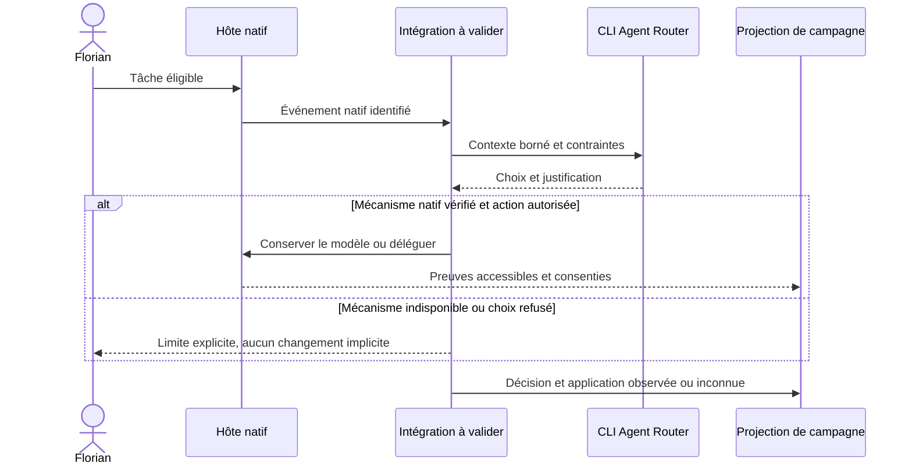

# Agent Router : état courant et plan de validation

5 octobre 2026. Ce document remplace le plan A1-A8 après les revues
`critique-arch` et `critique-plan`. Le [rapport de critique](finalization-critique-2026-10-05.md)
conserve les constats, leurs sources et le hash de la version auditée.
Il s'agit d'un plan de livraison, pas d'une déclaration de fonctionnalités actives.

## État vérifié le 6 octobre 2026

Les PR [#125](https://github.com/FlorianBruniaux/agent-router/pull/125) et
[#126](https://github.com/FlorianBruniaux/agent-router/pull/126) sont fusionnées.
La référence livrée est `8983d23a2e8937e244cf64ca0f2ba422073b20ae` sur `main`.
Le checkout principal de Florian reste préservé.

| Périmètre | Livré ou observé | Limite restante |
| --- | --- | --- |
| U03, bilan par exécution | Lignes et provenance dans le rapport ; formats historiques lisibles | Une ligne de feedback ne prouve pas le succès fonctionnel |
| U04a, coût des tentatives enregistrées | Rapport v3 et résumé v2 : chaque tentative comptée une fois, sous-total connu, couverture explicite | U04b doit relier escalades et occurrences de tâche, et conserver les tentatives sans feedback ; U05 doit qualifier le cache |
| Autorité réseau | Contrat explicite et refus du mode `ControllerBrokerOnly` non implémenté | La composition complète du runtime reste à prouver |
| U02, diagnostic Codex | Compteur HTTP corrigé ; paramètres et sortie corrélés face à un fournisseur simulé | La présence du canari dans la requête ne prouve pas son appel ni le routage automatique |

[Validation locale du 6 octobre](verification-2026-10-06.json) : 1 575 tests
workspace réussis en séquentiel, 42 ignorés et 292 filtrés. Un test de saisie
interactive avait dépassé son délai en parallèle, puis réussi isolément ; sa
cause reste inconnue et aucun délai ni assertion de ce test n'a changé.
Les deux suites Python totalisent désormais 42 tests réussis (29 + 13).
Le test de nettoyage Linux distingue un descendant mort en attente de récupération
d'un processus vivant, sans modifier le nettoyage produit. Formatage, Clippy,
harnais et recherche de secrets ont réussi.

Les 11 contrôles GitHub de la tête `2f50bcb5c069b12e35c45842c69eb6ae43d23da2`
ont réussi avant fusion, dont les suites Linux/macOS et le runtime Linux natif
([contrôles de la PR](https://github.com/FlorianBruniaux/agent-router/pull/126/checks)).
Après fusion, les quatre workflows de `8983d23a` ont échoué sans exécution
d'étape : GitHub indique un paiement en échec ou un plafond Actions à relever
([diagnostic post-fusion](https://github.com/FlorianBruniaux/agent-router/actions/runs/37416315096)).
La validation GitHub post-fusion reste non obtenue. À la demande de Florian,
la validation se poursuit en local sans budget Actions. Aucune modification
de facturation n'a été effectuée.

[Validation locale complète disponible sur ce Mac](verification-local-ci-2026-10-06.json),
proposée dans la [PR #127](https://github.com/FlorianBruniaux/agent-router/pull/127) :
1 575 résultats de tests Rust workspace, 1 test du cœur minimal et les 42 tests
ignorés ont réussi ; les suites Python totalisent 191 tests réussis. Formatage,
Clippy complet et minimal, harnais, syntaxe hôte, recherche de secrets dans les
fichiers et l'historique, audit RustSec frais et archive du cœur passent.
Les trois smokes de fuzzing passent aussi sur une copie isolée du même code Rust.

Le premier passage sur `2326346` conserve son échec de découverte Python
(0 test exécuté). Le correctif `1b3a2de` lance les six fichiers directement :
113 tests de tooling passent, complétant les 78 tests Python du banc déjà réussis.
Seuls le lanceur et ses tests ont changé entre ces deux références ; le Rust
n'a pas été rejoué après cette correction. Le pin OpenSSL local a aussi été
mis à jour de 3.6.4 vers 3.6.5, avec refus explicite des autres versions.

Le [guide local](../local-ci.md) fournit la commande et les limites. Trois
comportements Linux restent non vérifiés sur cette machine ; aucun moteur
Linux local actif n'est disponible. La PR #127 n'est pas fusionnée et ces
contrôles ne prouvent ni l'activation automatique ni un gain d'usage.

## Prochaines livraisons et suivi

| Ordre | Action | Critère de sortie | Suivi |
| --- | --- | --- | --- |
| 1 | Prouver le parcours Codex CLI macOS avec fournisseur simulé | Appel d'outil code-mode corrélé, résultat repris par Codex, refus des appels inattendus, nettoyage et retrait vérifiés dans une nouvelle session | U02/U06, [roadmap #11](https://github.com/FlorianBruniaux/agent-router/issues/11) |
| En parallèle | Compléter la comptabilité des tâches | Escalades, échecs, tentatives sans feedback et cache traités sans doublons ni total inventé | U04b/U05, [évaluation #5](https://github.com/FlorianBruniaux/agent-router/issues/5) |
| Après preuve native | Préparer l'activation automatique | Déclenchement unique, choix appliqué ou refus explicite, panne et retour arrière testés ; candidat global approuvé avant installation | U07, roadmap #11 |
| Après mesure et intégration validées | Calibrer puis comparer sur des tâches réelles | Plafond approuvé, tâches de confirmation distinctes, qualité, corrections, temps humain et coût par accepté, échecs et inconnus conservés | U08/U09/U10, évaluation #5 |

Codex CLI, l'application Codex et Claude ont des validations séparées. Aucun
gain de coût ou de productivité n'est établi par les contrôles de développement.
L'[epic d'observabilité #115](https://github.com/FlorianBruniaux/agent-router/issues/115)
reste ouverte avec ses propres critères ; U03/U04a ne la clôturent pas.

À chaque lot validé ou blocage nouveau, l'agent chargé du lot met à jour cette
section et l'issue concernée avec le comportement livré, la PR et le SHA,
les tests réellement exécutés, les limites et la prochaine preuve attendue.
Les résultats d'une campagne vont aussi dans le [playbook](playbook.md).
Conserver les échecs historiques et les exports scellés. Distinguer implémenté,
poussé, fusionné, CI avant/après fusion, usage natif et gain mesuré ; ne cocher
une unité ou fermer une issue que lorsque ses critères sont satisfaits.

<details><summary>Historique des validations antérieures à la fusion de #126</summary>

Mise à jour du 6 octobre : le commit `f637d0a` est publié sur la branche dédiée.
Les trois workflows GitHub ont réussi sur ce SHA, dont les tests Linux/macOS,
l'audit des dépendances et le contrôle runtime Linux. La suite locale parallèle
a également réussi : 1 563 tests, 42 ignorés, 292 filtrés, aucun échec.
La revue a ensuite corrigé un faux positif du compteur HTTP du probe U02,
reproduit par neuf cas de régression ; les 13 tests de fixture passent.
Le [nouvel essai natif](native-integration-u02/result-v4.json) confirme les
paramètres, la sortie et les compteurs corrigés, mais le canari d'outil manque
toujours. U02/U06/U07 restent non validés. Aucun gain d'usage n'est établi.
Les états non commités ci-dessous décrivent la référence historique du 5 octobre.

La PR [#125](https://github.com/FlorianBruniaux/agent-router/pull/125) est fusionnée
dans `main` au commit `87ee0752`, après réussite de tous ses contrôles GitHub.
U04a est ensuite implémenté et revu : le rapport v3 et le résumé v2 comptent
chaque tentative enregistrée une fois, conservent un sous-total connu et refusent
un total complet si la couverture ou la portée manque. Les formats historiques
restent validables. [Validation du 6 octobre](verification-2026-10-06.json) :
1 575 tests workspace réussis en séquentiel, 42 ignorés et 292 filtrés ; un test
de saisie interactive avait dépassé son délai en parallèle, puis réussi isolément.
Aucun délai ni assertion n'a été modifié. Les 35 tests Python des deux fixtures,
Clippy, le formatage, le harnais et la recherche de secrets passent.

U04 reste partiel : U04b doit relier les escalades à une occurrence de tâche et
conserver les tentatives sans feedback. U05 doit qualifier les prix cache.
Le [diagnostic complémentaire Codex](native-integration-u02/canary-diagnosis/README.md)
montre que `tools=[]` ne suffit pas à conclure à l'absence de canari dans la
requête ; un callback code-mode complet reste à vérifier. U02/U06/U07, la
campagne réelle et la publication du périmètre complet restent ouverts.

</details>

Les sections suivantes conservent le plan et les observations du 5 octobre.
Leurs états locaux historiques sont remplacés, pour l'avancement courant,
par les deux sections ci-dessus ; leurs critères non satisfaits restent applicables.

## Résultat recherché et limites actuelles

Après installation consentie, une tâche éligible déclenche Agent Router dans
l'hôte choisi. Le choix est expliqué, appliqué par un mécanisme autorisé ou
explicitement refusé, et relié à un résultat. Florian lit ensuite un bilan des
tâches acceptées, essais ratés, corrections, consommation et données inconnues.
La désactivation restaure l'usage précédent.

État conservé : routage et explication CLI rejoués avec succès ; découverte
Codex passive ; callback Codex réel via fournisseur local simulé réussi ;
parcours Claude isolé non concluant ; supervision complète non prouvée.
Le résultat Codex de 800 ms et 0 USD est une preuve de protocole locale, sans
sandbox réseau, pas une mesure de productivité.

Au moment de la critique du 5 octobre, la suite antérieure rapportait 1 560 tests réussis,
42 ignorés et 292 filtrés, avec formatage et Clippy verts. Aucun de ces tests
n'avait été relancé pour cette critique. Les changements réseau étaient alors non commités.

## Ce qui change par rapport au plan précédent

| Constat | Correction |
| --- | --- |
| F1, application native supposée | U02 prouve un host, une surface, une version et un mécanisme avant U07 |
| F2, origine de la mesure M1 indéfinie | U03 sépare explicitement preuve AR et capture native externe |
| F3, lots A1/A2/A5 trop larges | Référence bornée, premier rapport puis invariants de coût ; runtime découpé |
| F4, mono-session non raccordée | U06 vérifie une vraie exécution unique, pas seulement un intitulé de preset |
| F5, expérience trop large trop tôt | Calibration progressive, confirmation distincte ; aucun gain déduit du premier bloc |
| F6, restauration partielle | Règles propres au hook, aux données, aux processus et aux appels ambigus |

La première surface candidate est Codex CLI sur macOS, car une interface
app-server locale a déjà une preuve de protocole. Cela ne prouve pas un hook
de routage quotidien. U02 teste cette hypothèse ; Codex App et Claude ont des
verdicts distincts. Si une autre surface satisfait d'abord le contrat, consigner
le choix et son motif avant de modifier U07.

## Architecture proposée et source de chaque fait

Le cœur reste une CLI locale. Le conseil ne nécessite ni nouveau daemon ni
cc-bridge. Conserver le modèle courant est un choix autorisé. La supervision
AR garde les trois rôles de l'ADR 0022 : broker fournisseur, contrôleur natif et
exécutant des outils. Le mode local `ControllerBrokerOnly` refuse encore :
sa présence ne constitue pas sa mise en œuvre.

Parcours natif proposé, à prouver en U02 puis U07 :



| Fait | Source admissible |
| --- | --- |
| Choix calculé | Sortie CLI liée au contexte, catalogue et politique |
| Invocation native externe | Capture consentie de la surface testée, identité de session et provenance ; sinon UNKNOWN |
| Exécution supervisée AR | Reçu, journal et feedback du runtime existant |
| Usage fournisseur | Métadonnées natives, avec portée et provenance ; absence conservée |
| Résultat accepté | Tests liés au patch et verdict humain selon le manifeste |
| Temps humain | Saisie séparée ; jamais inféré du temps machine |

Le manifeste relie les éléments expérimentaux ; l'export nettoyé est une
projection, pas une deuxième autorité d'exécution. Ne jamais inventer de reçu AR
pour une session externe. Si l'on ne peut pas relier choix, invocation et usage,
la ligne reste présente avec ses inconnus.

Distinguer deux comportements en panne : le conseil échoue sans bloquer l'usage
normal de l'hôte ni changer son modèle ; une exécution supervisée dont l'autorité
est invalide reste bloquée. Aucune dégradation ne doit ouvrir des permissions.

## Phases et premières livraisons

Exécution du 5 octobre : U01 a fixé la référence
`9d77f5f7e1db8a7e5a45b2c5c5b3b9c3a619a981`, les modifications runtime préexistantes
et 168 préimages, puis les préimages documentaires supplémentaires. Les agents
ont des fichiers distincts. L'implémentation U03 a été préparée dans une copie
temporaire autorisée par le sandbox, revue indépendamment, puis intégrée après
comparaison de chaque préimage et vérification des huit empreintes finales.

Le [diagnostic U02](native-integration-u02/README.md) confirme la transmission
de paramètres et la corrélation de sortie sur Codex app-server 0.159.2 face à
un fournisseur simulé. Le canari d'outil était absent de la projection directe ;
le probe global restait rouge. Le [diagnostic complémentaire du 6 octobre](native-integration-u02/canary-diagnosis/README.md)
ne permet pas d'en déduire son absence de la requête entière. L'intégration
automatique n'est pas admise ; U06/U07 restent bloqués.
Le [candidat U08](calibration-v2/README.md) fournit le protocole et le modèle
de manifeste ; corpus final, paramètres et approbation de campagne restent à remplir.

U03 est livré localement : rapport v2 avec lignes par exécution et provenance,
anciens rapports v1 toujours validables. Revue indépendante sans correction
bloquante. [Relevé de validation](verification-2026-10-05.json) : formatage,
Clippy workspace, recherche de secrets et parité du harnais réussis ; activation
runtime du harnais toujours UNKNOWN. Les 17 tests Python du candidat de banc et
les 8 tests hors ligne du probe natif passent.

La première suite workspace en parallèle a échoué sur six délais runtime.
La cible concernée a passé ses 45 tests actifs en séquentiel, puis la suite
complète a terminé avec 1 563 tests réussis, 42 ignorés et 292 filtrés dans les
résumés de test, sans échec, via `--test-threads=1`. La charge observée soutient
l'hypothèse de contention sans en prouver la causalité. Aucun délai, assertion
ou fichier runtime préexistant n'a été changé. La fiabilité du passage parallèle
reste à qualifier ; ce résultat n'est pas une preuve d'intégration native active.

### Phase 0 : lever les inconnues qui conditionnent l'intégration

- [x] U01 : fixer les fichiers et critères de la tranche suivante.
- [ ] U02 : prouver le contrat natif de déclenchement et d'application.
- [ ] U18 : maintenir le registre complet en parallèle, sans bloquer U03.

Décision : U02 valide ou refuse chaque capacité séparément. En cas de refus,
continuer la mesure hors ligne et le diagnostic ; ne pas annoncer le mode
automatique et ne pas développer un compagnon de substitution sans besoin établi.

### Phase 1 : une seule modification produit, un rapport minimal

- [x] U03 : une tâche synthétique ou enregistrée produit un rapport lisible
  conservant succès, échec et UNKNOWN, avec origine des preuves.

Commencer par un cas RED qui expose la lacune, puis le raccord minimal au rapport
existant. Ne pas implémenter toute l'epic d'observabilité. Validation : même entrée,
même rapport ; échec visible ; aucune autorité native externe fabriquée.

### Phase 2 : fermer les invariants puis faire un essai quotidien

U04-U07 complètent le coût et le parcours natif. U08 prépare le manifeste.
Une calibration U09 devient possible uniquement après leur validation et avec
un plafond de dépense approuvé. U10 confirme sur des tâches tenues à l'écart.

### Phase 3 : fermer la supervision et la livraison

U11-U16 avancent dans une voie distincte ; leurs résultats ne sont pas déduits
du conseil. U17 livre le périmètre vérifié. Les exigences hors de cette tranche
restent dans U18 avec leur déclencheur, sans être déclarées terminées.

## Graphe de livraison

Chaque unité livre un comportement ou une décision vérifiable. Les dépendances
ci-dessous remplacent les anciennes arêtes implicites A1-A8. Une gate humaine
mentionnée dans la validation doit aussi être satisfaite avant l'effet concerné.

| Unité | Livre | Bloqué par | Validation observable |
| --- | --- | --- | --- |
| U01 | Référence bornée du prochain scénario | None | SHA, diff local, fichiers possédés, critères et sources recensés ; préimages conservées ; aucune mutation du checkout principal |
| U02 | Verdict d'intégration native | U01 | Événement, task/session id, modèle/effort, sortie et désactivation testés sur une surface/version ; verdict par capacité, y compris Unsupported |
| U03 | Première ligne de bilan complète | U01 | Fixture avec succès, échec et usage manquant affichés sans inventer reçu ou consommation ; projection reproductible |
| U04 | Total par tâche incluant les tentatives | U03 | Deux essais distincts puis succès et trois snapshots : chaque consommation comptée une fois ; escalade, abandon et zéro succès couverts |
| U05 | Coût cache correctement qualifié | U04 | Fixture cache lu/écrit/reasoning tarifée selon le contrat versionné ; format ancien lisible ; prix ou classe absente = approximation explicite ou UNKNOWN |
| U06 | Choix mono-session réellement applicable | U02, U03 | Décision suivie d'une seule session native autorisée ; vérification locale sans deuxième appel modèle ; conserver le modèle courant est traçable |
| U07 | Parcours natif automatique mesuré | U02, U03, U06 | Nouvelle session, tâche éligible, un déclenchement utile, choix suivi/refusé, résultat relié, panne sans boucle et retrait vérifié ; candidat approuvé avant installation globale |
| U08 | Corpus et protocole de calibration | U01 | Règle de sélection, tests d'acceptation, baselines, données requises, reprises et arrêts écrits ; historique inchangé |
| U09 | Calibration du parcours natif | U04, U05, U07, U08 | Plafond approuvé ; collectes et refus éprouvés ; coût/dispersion observés ; aucun claim de gain |
| U10 | Verdict comparatif du parcours testé | U09 | Confirmation préenregistrée sur tâches hors calibration ; analyse conservant échecs/inconnus ; résultat positif, négatif ou inconclusif reproductible |
| U11 | Admission Codex par outils | U01 | Vrai binaire épinglé + fournisseur simulé : appel autorisé, résultat repris, outils supplémentaires classifiés/testés, refus sans effet et annulation |
| U12 | Admission Claude par outils | U01 | Hypothèse de démarrage documentée, puis mêmes preuves que U11 ; échec borné donne un diagnostic, pas un élargissement de droits |
| U13 | Boucle AR locale Codex | U03, U11 | Runtime et vrai contrôleur produisent le patch attendu via exécutant séparé ; faux fournisseur ; profils OS, fichiers interdits, panne et cleanup testés |
| U14 | Frontière d'envoi et budget | U04, U05, U13 | Réservation avant chaque envoi physique, concurrence, timeout ambigu, refus/retry explicite, destination/TLS bornés avant tout fournisseur distant |
| U15 | Boucle AR locale Claude | U12, U13 | Adaptateur Claude dans la composition déjà testée ; même patch, séparation et scénarios de refus, avec fausse clé et fournisseur local |
| U16 | Matrice réelle de supervision | U08, U14, U15 | Plafond approuvé ; tâche réelle par hôte, patch validé, usage/identité qualifiés, canaris macOS/Linux du code annoncé ; état séparé pour chaque case |
| U17 | Candidat publiable du périmètre choisi | U08, U10, U16 | Corpus humain requis, gates, revue, installation/retrait et licences validés ; version/SHA distribués et preuves compatibles ; annonce sans extension de portée |
| U18 | Registre du périmètre restant | U01 | Chaque exigence applicable liée à un propriétaire, un déclencheur, une preuve attendue et une décision de périmètre explicite |

**Frontière initiale : U01.** Après U01 : U02, U03, U08, U11, U12 et U18 sont
éligibles, pas tous lancés simultanément. Priorité pratique : U02 et U03 ; le
diagnostic U11/U12 avance dans un créneau indépendant. U05 suit U04 car ils peuvent
toucher les mêmes contrats de prix/rapport. Aucun partage implicite de fichiers.

Un verdict Unsupported clôt un diagnostic, pas sa condition d'intégration :
U06/U07 exigent les capacités nécessaires effectivement vérifiées en U02.
U13 exige l'admission positive U11 ; U15 exige l'admission positive U12.
Un diagnostic négatif ne débloque jamais le dispatch de son hôte.

Une case hôte/OS non validée ne devient pas verte parce qu'une autre passe.
U16 peut commencer ses préparatifs et ses cas déjà admis, mais ne clôt pas la
matrice tant que les cases exigées pour la livraison sont inconnues.
Une publication expérimentale plus étroite que U17 exige un périmètre nommé ;
elle ne ferme ni le MVP complet ni les autres exigences.

## Responsabilités et tests avant code

| Travail | Propriétaire proposé | Revue |
| --- | --- | --- |
| U01/U08/U18 et critères humains | Agent principal + requirements analyst + Florian | Cohérence de périmètre et fuites de solution |
| U02/U06/U07 | Architecte système puis implémenteur, chemins d'intégration explicitement attribués | Reviewer Rust/sécurité sur autorité et comportement natif |
| U03/U04/U05 | Architecte back-end, implémenteur sur feedback/eval/CLI | Test engineer sur régressions puis reviewer indépendant |
| U11-U16 | Explorateur du protocole puis implémenteur adaptateur/runtime | Test engineer et reviewer sécurité, jamais l'auteur seul |
| U09/U10/U17 | Agent principal, test engineer et Florian | Validation des résultats/artefacts indépendante |

U03-U07 et U13-U15 suivent RED, correction minimale, GREEN : écrire d'abord le
cas comportemental qui manque ou échoue. Conserver les fixtures du harness
séparées de celles du produit. Un constat sur la déduplication du rapport n'est
pas une preuve de perte de coût tant que la chaîne entière n'a pas été testée.

Pour les formats larges : ajouter un format versionné avec lecteur compatible,
migrer les producteurs par unité, puis retirer l'ancien chemin seulement après
validation de tous ses appelants. Ne jamais tester un downgrade destructif sur
le stockage privé de Florian.

## Expérience minimale et règles de mesure

Calibration : commencer avec A-v2 et E sur un bloc de tâches appariées. A-v2 peut
rester mono-session ; E est une session frontier avec effort fixé. Ajouter D,
choix habituel, s'il diffère de E ; ajouter S, règle économique, seulement pour
une hypothèse fixée avant le bloc concerné. G/B/C historiques restent disponibles
pour expliquer une cause, sans être un péage systématique.

La confirmation choisit et scelle ses comparateurs après calibration et avant
résultats. Si D ou S diffère et a été retenu comme concurrent pertinent, le
conserver dans cette confirmation. Il est interdit de retirer après coup une
baseline parce qu'elle gagne. Le plan A-v1 et ses chiffres restent historiques.

Un manifeste lie tâches, points de départ, scripts et hashes, modèles/efforts,
configuration, prix, ordre randomisé, répétitions, acceptation, règles de retry,
budgets et critères statistiques. Les tâches de calibration n'y entrent pas.
La taille se calibre ; aucun nombre de runs n'est présenté comme probant sans
justification. Corriger la contradiction p-values/intervalles du protocole
existant avant toute conclusion inférentielle. Sans règle validée, produire
un rapport descriptif et laisser l'adoption statistique inconclusive.

Deux corpus : tâches d'exécution avec tests et revue des patches ; pertinence
des agents/skills avec labels humains et rappel@5. Les 100 candidats documentés
du second corpus ne deviennent pas 100 validations humaines par génération.
Le seuil et l'échantillon tenu à l'écart sont figés avant réglage.

| Mesure | Règle |
| --- | --- |
| Réussite | Acceptés sur toutes les tâches assignées ; UNKNOWN et abandons visibles ; pas uniquement les lignes de replay acceptées |
| Coût par accepté | Toutes tentatives du bras divisées par acceptés ; zéro accepté = indéfini ; coût manquant = total complet UNKNOWN avec sous-total et couverture |
| Cache | Prix versionnés, catégories réellement observées ; si le host ne distingue pas une catégorie tarifaire, ne pas inventer le prix exact |
| Temps | Temps machine, attente et revue/correction humaine séparés ; bornes fiables ou UNKNOWN |
| Application du conseil | Assignation, recommandation et invocation effective distinctes ; refus/ignorés conservés dans le groupe assigné |
| Automatisation | Déclenchements attendus, observés, doublons, erreurs et reprises manuelles |
| Valeur | Comparaison sur mêmes tâches/départs, sans fuite de solution ; résultat par hôte et catégorie prévue |

Le bilan quotidien utilise les exports nettoyés sous
`docs/bench/runs/<date>-<campagne>/`, avec entrée dans `playbook.md`.
C'est un suivi d'usage ; il ne fournit pas seul le contrefactuel nécessaire
pour attribuer une économie au routeur. Distinguer API estimée, quota observable
et facture d'abonnement. Ne pas inventer un coût monétaire du temps humain.

Un résultat M1 ne mesure pas le runtime AR de U13-U16. Si une économie de ce
runtime est revendiquée, reprendre U08-U10 pour ce traitement exact après U16.
Un rapport natif positif ne sera pas réétiqueté « gain runtime ».

## Modes dégradés, arrêt et rollback

| Incident | Action bornée | Preuve de restauration ou de limite |
| --- | --- | --- |
| Intégration de conseil défaillante | Désactiver le composant de ce projet, continuer le host avec son choix antérieur | Nouvelle session sans déclenchement résiduel ; paramètres antérieurs identiques |
| Données de mesure indisponibles | Conserver l'essai et signaler UNKNOWN ; aucune relance pour réparer les métriques | Travail non répété, diagnostic visible, couverture diminuée |
| Nouveau format incorrect | Arrêter son écriture, conserver ses données, repointer la lecture sur la version compatible | Archives anciennes relues sans changement ; aucune base privée rétrogradée |
| Exécutant ou contrôleur bloqué | Arrêter les nouvelles tentatives, annuler le run possédé et vérifier son cleanup | Pas d'effet supplémentaire ; patch non intégré sans validation |
| Appel fournisseur d'issue inconnue | Conserver la réservation conservatrice et le coût inconnu ; pas de retry automatique | Tentative ambiguë visible ; nouvelle tentative distincte seulement si autorisée |
| Binaire du host changé | Invalider sa preuve d'admission et rejouer le probe concerné | Aucun fallback vers des permissions plus larges |

Avant modification d'une intégration : préimages, hashes et sauvegarde des seuls
fichiers concernés. Pour le global : candidat inerte testé, diff expurgé, digest,
approbation liée au digest, puis comparaison des préimages avant écriture.
Lors de la restauration, exclure les écritures concurrentes ; comparer à la
dernière version écrite ; restaurer l'existant et retirer seulement les nouveaux
fichiers inchangés de cette intervention, puis les dossiers uniquement s'ils sont
vides. Si un tiers a modifié l'état, ne pas écraser. Conserver le journal de
vérification hors des fichiers retirés.

La charge initiale est une tâche active. Les tests de concurrence vérifient
l'intégrité, pas un débit commercial. Les timeouts et bornes de sortie de
l'intégration sont figés en U02 à partir du contrat natif, puis testés aux limites.
Les essais fournisseur nécessitent un plafond concret approuvé. Si le chemin
ne permet qu'un budget suivi et non un plafond strict, l'indiquer avant accord.

## Hors de la première tranche, avec déclencheurs

| Élément | Déclencheur de reprise et propriétaire |
| --- | --- |
| Timeline détaillée #117/#118 | Première ligne U03 livrée ; backend/runtime ajoute les durées ou vues nécessaires à un diagnostic observé |
| Diagnostics #119 et export consommateurs #120 | Contrat #116 stable et données sources disponibles ; propriétaires runtime/CLI |
| Pixel #122/#123 | U10 fournit une référence stable ; retrieval/eval teste une hypothèse d'apport de contexte |
| Mods parent Claude #124 | Contrat de cible et autorité distinct accepté, puis canary natif ; architecte système |
| cc-bridge | Contrat U14 stabilisé et besoin de transport établi ; test local signé avant intégration, deux dépôts conservés |
| Windows, UI et autres exigences complètes | Registre U18 : priorité/déclencheur et critère propres ; changement de périmètre uniquement explicite |
| Apprentissage actif | Corpus humain et held-out conformes aux gates de promotion ; aucune activation automatique |

Le plan ne retire aucune exigence de la spécification. M1 est un essai
instrumenté ; M2 requiert les critères MVP et le support annoncé ; la clôture
du projet complet requiert aussi les dispositions d'U18. Le démarrage à froid
documenté au-dessus de 150 ms reste un critère non satisfait : le remesurer sur
le candidat ou faire accepter sa révision, jamais le remplacer par le temps chaud.

## Livraison et critères finaux

- [ ] Chaque unité validée possède source, version, commande/scénario et résultat.
- [ ] Automatisation, permission native, exécution AR et gain mesuré restent séparés.
- [ ] Les dix critères MVP sont vérifiés : deux hôtes réels, fixtures explicables,
  corpus humain, contraintes, reprise, intégration explicite, secrets, cœur local,
  identité sourcée/UNKNOWN et licences.
- [ ] Toute affirmation par OS et surface a sa preuve ; CLI ne vaut pas App.
- [ ] Installation propre et retrait, archivage, notices et secrets sont contrôlés.
- [ ] Le SHA publié correspond aux preuves ; si un changement affecte le traitement
  mesuré, rejouer les validations concernées avant d'en conserver les conclusions.

Pour les lots de code, après tests ciblés et revue :

```sh
cargo fmt --all -- --check
cargo clippy --workspace --all-targets --all-features --locked -- -D warnings
cargo test --workspace --all-features --locked
cargo run -p xtask --locked -- check
```

Utiliser `rtk`. Les tests à sockets et les canaris OS ont leurs conditions propres.
Gitleaks si installé ; vérifier la disponibilité des autres outils sans installation
automatique. La CI et le SHA distant sont des preuves distinctes des gates locales.
La licence FSL actuellement documentée doit être clarifiée avant l'annonce
« open source » ; aucune licence n'est changée par ce plan.

À soumettre à Florian au bon moment, sur candidats concrets : budget de calibration
puis confirmation, seuils qualité/coût/temps avant confirmation, digest d'installation
globale et choix de publication/licence. Aucune estimation calendaire n'est inventée.

## Références et périmètre de cette révision

- [Critique et sources de code](finalization-critique-2026-10-05.md)
- [Critères fonctionnels](../specs/functional-specification.md)
- [Complétion et critères historiques](../completion.md)
- [Protocole expérimental à amender](router-value-protocol.md)
- [Pilote et registre](playbook.md)
- [Outcome measurement](../adr/0019-outcome-measurement.md)
- [Frontière fournisseur/outils](../adr/0022-provider-egress.md)
- [Preuves natives](egress-admission/README.md)
- [Distribution](../distribution.md)

État GitHub lu au tour précédent : 12 issues ouvertes, 0 PR ouverte.
Ces nombres ne sont pas un décompte de défauts et n'ont pas été rafraîchis pour
cette critique. Base du worktree : `9d77f5f7e1db8a7e5a45b2c5c5b3b9c3a619a981`,
avec changements locaux préservés. Worktree :
`/Users/florianbruniaux/.codex/worktrees/role-network-policy/agent-router`.
Cette révision modifie deux documents seulement, sans code produit, appel
fournisseur, configuration, commit, push ni publication.
