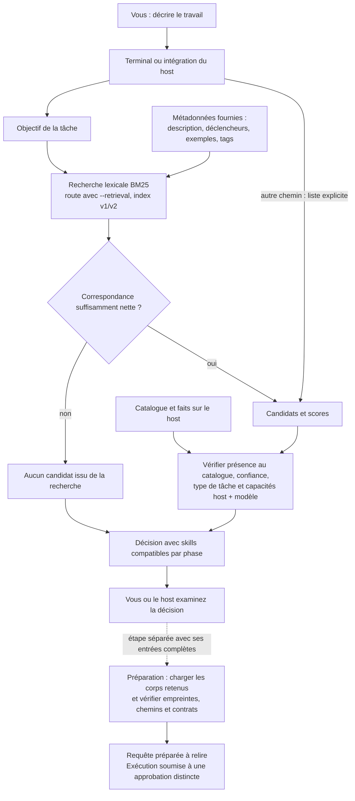

# Du besoin à la suggestion de skills

Agent Router peut proposer des instructions adaptées à une tâche, comme une
méthode de test ou de revue. Il cherche d’abord dans des descriptions de skills,
puis vérifie leur compatibilité. La décision contient des identifiants de skills ;
leur contenu est chargé séparément lors de la préparation.

## Qui déclenche quoi ?

| Besoin | Entrée explicite | Résultat |
| --- | --- | --- |
| Trouver des skills pertinents | `search` reçoit une requête et des métadonnées | Candidats classés, scores et indices de correspondance, ou abstention |
| Les associer à un plan | `route --retrieval` reçoit tâche, catalogue et métadonnées v1/v2 | Recherche sur l’objectif, puis skills compatibles par phase |
| Proposer une liste déjà connue | `route` reçoit `skill_candidates` dans sa requête | Le catalogue et les capacités filtrent cette liste |
| Charger les instructions retenues | `prepare` reçoit un manifeste de préparation complet | Corps sélectionnés et vérifiés dans une requête préparée, sans lancement |

Vous pouvez appeler la CLI depuis un terminal. Une intégration Claude Code ou
Codex peut faire cet appel pour vous, mais ce déclencheur doit être raccordé
explicitement. L’[API locale](local-api.md) reçoit les candidats dans la requête ;
elle n’a pas d’équivalent de l’option CLI `--retrieval`.



Ce schéma décrit le chemin des skills dans `route`, pas tous les contrôles de
routage des modèles. Une liste de skills vide peut laisser un plan valide ;
les autres contraintes peuvent aussi aboutir à une absence de route. Une décision
`route` ne constitue pas à elle seule un manifeste utilisable par `prepare`.

## Comment un candidat est retenu

1. **L’appelant fournit les données.** Le moteur reçoit des métadonnées, sans
   scanner automatiquement les dossiers personnels. L’[importeur Markdown](importer.md)
   est une bibliothèque séparée : il produit un candidat non signé à partir d’un
   dossier explicitement fourni. Importer ne rend pas un skill digne de confiance.
2. **La recherche compare des mots.** BM25 classe les correspondances dans
   l’identifiant, les types de tâche, les déclencheurs, la description, les exemples,
   les tags et les chemins déclarés. Un déclencheur négatif peut exclure un asset.
   Cette recherche ne lit pas les corps et n’appelle aucun modèle. Elle ne comprend
   pas automatiquement les synonymes ou la négation d’une phrase.
3. **Le moteur peut s’abstenir.** Une recherche vide, sans correspondance, trop
   faible, ambiguë ou ne trouvant que des assets non fiables ne fournit aucun
   candidat à `route`. Avec `--retrieval`, ce résultat remplace la liste déjà
   présente dans la requête. `search` expose le diagnostic détaillé ; `route`
   reçoit la liste résultante.
4. **La politique vérifie la compatibilité.** Le skill doit exister dans le
   catalogue, avoir une confiance admise, couvrir le type de tâche et disposer
   des capacités requises à la fois côté host et modèle. Un bon score ne suffit
   pas. Les doublons sont regroupés sans cumuler artificiellement leur bonus.
5. **Le plan conserve les identifiants.** Dans ce chemin, la compatibilité des
   skills dépend de la tâche et du modèle de chaque phase ; ce n’est pas une
   recherche indépendante par phase. La [préparation](preparation.md) charge les
   corps sélectionnés dans un contexte validé, vérifie chemins, empreintes et
   contrats, puis assemble les instructions. Le texte d’un skill n’accorde aucune
   permission d’exécution.

Les métadonnées v2 lient la recherche au contenu exact du catalogue. La recherche
contextuelle v3 peut aussi exploiter les langues, les outils disponibles et un
historique de résultats fourni, avec provenance. Elle passe par
`search --context-query` : **`route --retrieval` ne consomme pas un index v3**,
qui exige ce contexte. Voir les [contrats de recherche](retrieval.md) pour les
signaux, l’option sémantique et les cas de refus.

Le [hook du harness de développement](harness.md#sessionstart-advisory-protocol) vérifie la
parité de la configuration du dépôt ; il ne déclenche pas ce parcours. Une
suggestion affichée par un hook personnel de skills est une intégration distincte.
Installer Agent Router ne l’active pas dans toutes les conversations.

## Essayer la recherche et le routage sans modèle

Depuis la racine du dépôt, avec `agent-router` compilé et accessible dans le
`PATH` ([installation](install.fr.md)), cet exemple crée uniquement des fichiers
jetables. Les modèles, capacités et permissions du catalogue d’exemple sont des
fixtures ; ils ne décrivent pas votre installation réelle. Le texte de description
est volontairement identique à l’objectif pour rendre la correspondance lisible.

```sh
AR_SKILL_DEMO=$(mktemp -d)
cat > "$AR_SKILL_DEMO/skills.json" <<'JSON'
{
  "schema_version": "1",
  "catalog_version": "codex-core-v1",
  "assets": [{
    "id": "tdd",
    "kind": "skill",
    "trust": "trusted_local",
    "description": "Implement a bounded parser change"
  }]
}
JSON

agent-router index --metadata "$AR_SKILL_DEMO/skills.json" \
  --catalog assets/catalogs/codex-core-v1.json --json \
  > "$AR_SKILL_DEMO/bound.json"

agent-router search --metadata "$AR_SKILL_DEMO/bound.json" \
  --catalog assets/catalogs/codex-core-v1.json \
  --query 'Implement a bounded parser change' --kind skill --json

agent-router route --request tests/fixtures/requests/codex-implementation.json \
  --catalog assets/catalogs/codex-core-v1.json \
  --retrieval "$AR_SKILL_DEMO/bound.json" --json \
  > "$AR_SKILL_DEMO/decision.json"

cat "$AR_SKILL_DEMO/decision.json"
```

La recherche doit sélectionner `tdd` et le plan doit lister `tdd` dans les
`skills` de ses trois étapes. La fixture de requête contient déjà un candidat :
`--retrieval` le remplace par celui de notre recherche. Aucun fichier `SKILL.md`
n’est chargé dans cette démonstration et aucun modèle n’est lancé. Les fichiers
restent dans le dossier temporaire indiqué par `$AR_SKILL_DEMO` pour inspection.
Ce résultat vérifie le raccord recherche/routage sur une fixture ; il ne mesure
pas la pertinence des suggestions sur vos tâches quotidiennes.

## Correspondance avec le code

- [CLI `route`](../crates/agent-router-cli/src/main.rs), fonction `route` : lit
  l’objectif, appelle la recherche optionnelle et remplace `skill_candidates`.
- [Recherche](../crates/router-retrieval/src/index.rs), `skill_candidates_validated` :
  limite la recherche aux skills, traite l’abstention et fournit les scores.
- [Politique](../crates/router-policy/src/preset.rs), `compatible_skills` : vérifie
  catalogue, confiance, type de tâche et capacités, puis déduplique.
- [Préparation](../crates/router-prepare/src/lib.rs) : charge les instructions
  retenues et contrôle leur liaison au contexte validé.
